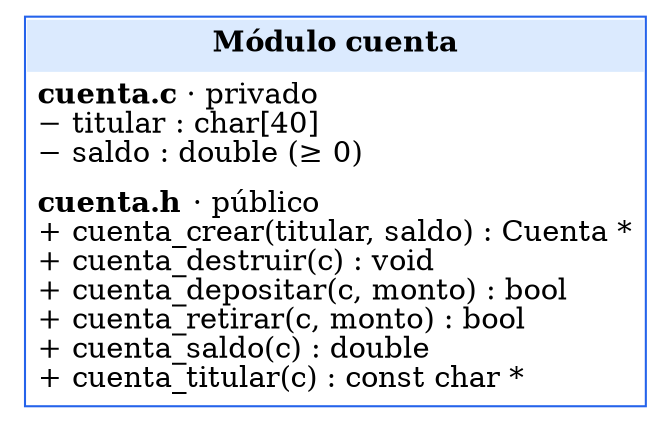

# 1. Información de soporte {.soporte}

:::analogia | El menú y la cocina
En un restaurante, el **menú** dice qué platillos puedes pedir, qué traen y cuánto cuestan; la **cocina** es donde se preparan. Tú pides «enchiladas» sin entrar a la cocina ni saber la receta, y el chef puede cambiar de proveedor o de técnica sin reimprimir el menú. Un **módulo** de C funciona igual: el archivo de **cabecera** (`.h`) es el menú (qué funciones hay y cómo se piden), el archivo de **implementación** (`.c`) es la cocina (cómo se hacen) y el resto del programa es el cliente, que solo conoce el menú.
:::

:::pregunta
Tu programa del registro escolar del Tema 16 ya rebasa las 150 líneas en un solo archivo. Si tres compañeros quieren trabajar en él al mismo tiempo, **¿cómo lo repartirían? ¿Qué pasa si dos personas editan el mismo archivo a la vez? ¿Qué impide que una parte del programa cambie datos que «no le tocan»?**

{{lineas:2}}
:::

:::relevancia
Todo programa real en C está dividido en módulos: el núcleo de Linux tiene decenas de miles de archivos `.c` y `.h`; el firmware de un microcontrolador (Arduino, ESP32) se organiza en un módulo por sensor; y las bibliotecas que usas desde el Tema 01 (`stdio.h`, `string.h`, `math.h`) son justamente **cabeceras de módulos ya compilados**. La idea de separar una interfaz pública de una implementación oculta es también el corazón de la programación orientada a objetos (C++, Java, Python): este tema es tu puente hacia ella. {{arcs:Relevancia}}
:::

## 1.1 Conceptos, uno por uno

:::concepto | 1 | Módulos: interfaz e implementación | Elementos aislados, Atención dividida
Un **módulo** agrupa los tipos y funciones de **una sola responsabilidad** (estadística, manejo de una pila, una cuenta bancaria) en dos archivos con el mismo nombre:

| Archivo | Papel | Contiene | Lo usa |
|---|---|---|---|
| `estadistica.h` | **interfaz** (el menú) | prototipos, `typedef`, `#define` y comentarios de uso | todo archivo que lo incluya |
| `estadistica.c` | **implementación** (la cocina) | las definiciones de las funciones y sus auxiliares privadas | solo el propio módulo |
| `temps.c` | **cliente** | `main` y el resto del programa | — |

Cada `.c` se compila **por separado** y el enlazador une los resultados (es la cadena de compilación del Tema 01, ahora con varios archivos):

```dot caption="Figura 1. Compilación de un programa con un módulo." w="92%"
rankdir=LR; nodesep=0.3; ranksep=0.45;
@file(h, "estadistica.h\ninterfaz")
@file(c, "estadistica.c\nimplementación")
@file(m, "temps.c\ncliente (main)")
@proc(cc1, "gcc -c\nestadistica.c")
@proc(cc2, "gcc -c\ntemps.c")
@sub(o1, "estadistica.o")
@sub(o2, "temps.o")
@proc(ld, "Enlazador\ngcc *.o")
@term(x, "temps\nejecutable")
h -> c [style=dashed, label=" #include"]; h -> m [style=dashed, label=" #include"];
c -> cc1 -> o1 -> ld; m -> cc2 -> o2 -> ld; ld -> x;
```

Ventajas: cada persona trabaja en su archivo, un cambio en la cocina solo obliga a recompilar ese `.c`, y los módulos se **reutilizan** en otros programas.
:::

:::concepto | 2 | Un primer módulo en tres archivos | Elementos aislados, Atención dividida
La cabecera dice **qué** hace cada función; la implementación, **cómo**. Los nombres públicos llevan el prefijo del módulo (`est_`) para no chocar con los de otros módulos: C no tiene espacios de nombres.

```c file=estadistica.h
#ifndef ESTADISTICA_H                              //> Guarda de inclusión (concepto 5)
#define ESTADISTICA_H

/* Módulo estadistica: cálculos sobre
   arreglos. Precondición: n > 0. */
double est_promedio(const double v[], int n);      //> Solo prototipos: QUÉ hace
double est_maximo(const double v[], int n);
double est_minimo(const double v[], int n);

#endif
```

```c file=estadistica.c
#include "estadistica.h"                     //> La implementación incluye su propia cabecera

double est_promedio(const double v[], int n) //> CÓMO lo hace: las definiciones
{
    double suma = 0;
    for (int i = 0; i < n; i++)
        suma += v[i];
    return suma / n;
}

double est_maximo(const double v[], int n)
{
    double m = v[0];
    for (int i = 1; i < n; i++)
        if (v[i] > m) m = v[i];
    return m;
}

double est_minimo(const double v[], int n)
{
    double m = v[0];
    for (int i = 1; i < n; i++)
        if (v[i] < m) m = v[i];
    return m;
}
```

```c run file=temps.c link=estadistica.c
#include <stdio.h>
#include "estadistica.h"     // comillas: se busca primero en la carpeta del proyecto

int main(void)
{
    double temps[] = {21.5, 24.0, 19.8, 26.3, 22.1};
    int n = sizeof temps / sizeof temps[0];
    printf("Promedio: %.2f\n", est_promedio(temps, n));
    printf("Maxima:   %.1f\n", est_maximo(temps, n));
    printf("Minima:   %.1f\n", est_minimo(temps, n));
    return 0;
}
```
El cliente `temps.c` no sabe cómo se calcula el máximo: solo conoce el prototipo. En un IDE, los tres archivos deben pertenecer al **mismo proyecto**.
:::

:::concepto | 3 | `#include`: el preprocesador copia la cabecera | Elementos aislados
`#include` no «importa» nada: el preprocesador **copia el texto** de la cabecera en el lugar de la directiva. La opción `-E` de gcc muestra el resultado (y `-P` omite las marcas de línea):

<div class="cols eq">
<div>

```c file=saludo.h
#ifndef SALUDO_H
#define SALUDO_H
/* Muestra un saludo personalizado */
void saludar(const char *nombre);
#endif
```

```c file=hola.c
#include "saludo.h"
int main(void)
{
    saludar("Ana");
    return 0;
}
```

</div>
<div>

```console run title="Terminal: lo que recibe el compilador"
$ gcc -E -P hola.c
```

</div>
</div>

El compilador recibe solo el prototipo: las directivas `#ifndef`/`#define`/`#endif` y el comentario ya se procesaron.

| Forma | Dónde busca | Para |
|---|---|---|
| `#include <stdio.h>` | en las carpetas del sistema | bibliotecas estándar |
| `#include "saludo.h"` | primero en la carpeta del archivo, luego en las del sistema | tus propios módulos |
:::

:::movimiento | Módulos humanos (10 min)
Tres estudiantes forman el módulo `cuenta`. Uno sostiene la **cabecera**: una tarjeta visible con las operaciones públicas («crear», «depositar», «retirar», «consultar saldo»). Los otros dos son la **implementación**: tienen una hoja **oculta** con el saldo y una regla privada («verificar fondos») que solo ellos usan. El resto del grupo es el **cliente** (`main`): solo puede pedir lo que está en la tarjeta (p. ej., «retira 500») y nunca ve la hoja. Después, la implementación decide en secreto guardar el saldo **en centavos**. Pregunta final: ¿qué tuvo que cambiar el cliente? ¿Por qué nadie pudo dejar la cuenta en −500?
:::

:::concepto | 4 | Compilación separada y enlazado | Elementos aislados, Atención dividida
Con `-c`, gcc **compila sin enlazar** y produce un archivo objeto `.o` por cada `.c`. Después, una orden sin `-c` **enlaza** los objetos en el ejecutable:

```console run title="Terminal: compilar por partes"
$ gcc -std=c17 -Wall -Wextra -c estadistica.c
$ gcc -std=c17 -Wall -Wextra -c temps.c
$ ls *.o
$ gcc estadistica.o temps.o -o temps
$ ./temps
```

| Fase | Revisa | Error típico con módulos |
|---|---|---|
| Compilación (`-c`), un `.c` a la vez | que cada función usada esté **declarada** (prototipo visible) | `implicit declaration of function` (falta el `#include`) |
| Enlace, todos los `.o` juntos | que cada función usada esté **definida exactamente una vez** | `undefined reference` (falta un `.o`) o `multiple definition` |

También se puede hacer todo en un paso: `gcc -std=c17 -Wall -Wextra temps.c estadistica.c -o temps`. La ventaja de compilar por partes aparece en proyectos grandes: si solo cambia `estadistica.c`, basta recompilar ese archivo y volver a enlazar (concepto 9).
:::

:::concepto | 5 | Guardas de inclusión | Elementos aislados, Autoexplicación
Una cabecera puede llegar **dos veces** al mismo `.c`: directamente y a través de otra cabecera que también la incluye. Aquí `main.c` incluye `punto.h` y luego `segmento.h`, que vuelve a incluir `punto.h`. Sin protección, la definición del tipo se repite:

<div class="cols eq">
<div>

```c file=punto.h title="punto.h (sin guardas)"
typedef struct Punto { double x, y; } Punto;
```

</div>
<div>

```c file=segmento.h title="segmento.h (sin guardas)"
#include "punto.h"
typedef struct { Punto a, b; } Segmento;
```

</div>
</div>

```c err
#include <stdio.h>
#include "punto.h"
#include "segmento.h"
int main(void)
{
    Segmento s = {{0, 0}, {3, 4}};
    printf("(%.0f, %.0f)\n", s.b.x, s.b.y);
    return 0;
}
```

La **guarda de inclusión** hace que la segunda copia se salte: la primera vez define el nombre `PUNTO_H`; la segunda, `#ifndef` («si no está definido») es falso y todo hasta `#endif` se ignora.

```c file=punto.h title="punto.h (con guardas)"
#ifndef PUNTO_H              //> ¿Es la primera vez que se incluye?
#define PUNTO_H              //> Marca: «ya se incluyó»
typedef struct Punto { double x, y; } Punto;
#endif                       //> Fin de la parte protegida
```

```c file=segmento.h title="segmento.h (con guardas)"
#ifndef SEGMENTO_H
#define SEGMENTO_H
#include "punto.h"
typedef struct { Punto a, b; } Segmento;
#endif
```

```c run title="segmentos.c"
#include <stdio.h>
#include "punto.h"
#include "segmento.h"
int main(void)
{
    Segmento s = {{0, 0}, {3, 4}};
    printf("(%.0f, %.0f)\n", s.b.x, s.b.y);
    return 0;
}
```
**Toda** cabecera lleva guardas, con un nombre único (normalmente el del archivo en mayúsculas). Muchos compiladores aceptan también `#pragma once`, pero no es parte de la norma C.
:::

:::concepto | 6 | `static`: lo que el módulo no comparte | Elementos aislados, Atención dividida
Fuera de una función, `static` limita un nombre a **su archivo** (enlace interno). Así el módulo esconde variables y funciones auxiliares, y otros módulos pueden usar los mismos nombres sin chocar. (Dentro de una función, `static` significa otra cosa: una variable local que conserva su valor, Tema 10.)

```c file=dado.h
#ifndef DADO_H
#define DADO_H
void dado_sembrar(unsigned semilla); // misma semilla, misma secuencia
int dado_tirar(void);                // un número de 1 a 6
#endif
```

```c file=dado.c
#include "dado.h"

static unsigned estado = 1;                  // Privada: ningún otro archivo la ve

static unsigned siguiente(void)              // Privada: solo existe dentro de dado.c
{
    estado = estado * 1103515245u + 12345u;  // El generador del ejemplo de rand en la norma C
    return (estado / 65536u) % 32768u;
}

void dado_sembrar(unsigned semilla) { estado = semilla; }

int dado_tirar(void) { return (int)(siguiente() % 6) + 1; }
```

```c run file=juego.c link=dado.c
#include <stdio.h>
#include "dado.h"
int main(void)
{
    dado_sembrar(2026);
    printf("Tiradas:");
    for (int i = 0; i < 10; i++)
        printf(" %d", dado_tirar());
    printf("\n");
    return 0;
}
```

Un cliente que intente usar la función privada compila (porque la declara), pero el **enlazador** no la encuentra:

```c file=trampa.c
#include <stdio.h>
unsigned siguiente(void);                    //> Declararla no basta: la definición es static en dado.c
int main(void)
{
    printf("%u\n", siguiente());
    return 0;
}
```

```console run rc title="Terminal"
$ gcc -std=c17 -Wall -Wextra -c dado.c trampa.c
$ gcc dado.o trampa.o -o trampa
```
:::

:::concepto | 7 | Tipos de datos abstractos: la estructura opaca | Elementos aislados, Atención dividida
En la cabecera se puede **declarar** una estructura sin decir sus campos: `typedef struct Pila Pila;`. El cliente puede tener **punteros** `Pila *`, pero no puede ver ni tocar los campos, que solo se definen en el `.c`. Como el cliente no sabe cuánto mide una `Pila`, el módulo la crea con `malloc` y la libera él mismo (Tema 15): de ahí las funciones `pila_crear` y `pila_destruir`.

```c file=pila.h
#ifndef PILA_H
#define PILA_H
#include <stdbool.h>

typedef struct Pila Pila;             //> Tipo incompleto: los campos no se ven

Pila *pila_crear(void);               //> NULL si no hay memoria
void pila_destruir(Pila *p);          //> Libera todo lo que el módulo reservó
bool pila_apilar(Pila *p, int x);     //> false si no hay memoria
bool pila_desapilar(Pila *p, int *x); //> false si está vacía
bool pila_vacia(const Pila *p);       //> const: solo consulta
int pila_tamano(const Pila *p);

#endif
```

```c file=pila.c
#include <stdlib.h>
#include "pila.h"

struct Pila                       // La definición completa vive SOLO aquí
{
    int *datos;
    int tope;                     // Cuántos elementos hay
    int capacidad;
};

Pila *pila_crear(void)
{
    Pila *p = malloc(sizeof *p);
    if (p == NULL) return NULL;
    p->capacidad = 4;
    p->tope = 0;
    p->datos = malloc(p->capacidad * sizeof *p->datos);
    if (p->datos == NULL) { free(p); return NULL; }
    return p;
}

void pila_destruir(Pila *p)
{
    if (p == NULL) return;
    free(p->datos);
    free(p);
}

bool pila_apilar(Pila *p, int x)
{
    if (p->tope == p->capacidad)  // Llena: duplicar la capacidad
    {
        int *nuevo = realloc(p->datos, 2 * p->capacidad * sizeof *nuevo);
        if (nuevo == NULL) return false;
        p->datos = nuevo;
        p->capacidad *= 2;
    }
    p->datos[p->tope++] = x;
    return true;
}

bool pila_desapilar(Pila *p, int *x)
{
    if (p->tope == 0) return false;
    *x = p->datos[--p->tope];
    return true;
}

bool pila_vacia(const Pila *p) { return p->tope == 0; }

int pila_tamano(const Pila *p) { return p->tope; }
```

```c run file=binario.c link=pila.c
#include <stdio.h>
#include "pila.h"

int main(void)
{
    Pila *p = pila_crear();
    if (p == NULL) return 1;
    int n = 156;
    printf("%d en binario: ", n);
    while (n > 0)                     //> Los residuos salen al revés…
    {
        pila_apilar(p, n % 2);
        n /= 2;
    }
    printf("(%d digitos) ", pila_tamano(p));
    int bit;
    while (pila_desapilar(p, &bit))   //> …y la pila los devuelve en orden
        printf("%d", bit);
    printf("\n");
    pila_destruir(p);
    return 0;
}
```

Si el cliente intenta tocar un campo, **el compilador lo impide**:

```c err
#include "pila.h"
int main(void)
{
    Pila *p = pila_crear();
    p->tope = 0;                      //> El cliente quiere «vaciarla» a mano
    return 0;
}
```

| Lo que en C++ o Java es… | …en un módulo de C es |
|---|---|
| una clase con atributos privados | una estructura opaca cuyos campos solo conoce el `.c` |
| métodos públicos | las funciones de la cabecera, que reciben el `Pila *` |
| métodos privados | funciones `static` del `.c` |
| constructor / destructor | `pila_crear` / `pila_destruir` (llamados explícitamente) |
:::

:::concepto | 8 | Ruta B · `extern`: compartir una variable entre módulos | Elementos aislados, Reversión de la experiencia
Una variable global se **define** en un solo `.c` (ahí se reserva su memoria) y se **declara** con `extern` en la cabecera para que otros archivos la usen:

```c file=bitacora.h
#ifndef BITACORA_H
#define BITACORA_H
extern int bitacora_nivel;                         // Declaración: existe en otro archivo
void bitacora_msg(int nivel, const char *mensaje); // se muestra si nivel <= bitacora_nivel
#endif
```

```c file=bitacora.c
#include <stdio.h>
#include "bitacora.h"

int bitacora_nivel = 1;                  //> Definición: se reserva aquí, una sola vez
static int contador = 0;                 //> Esta, en cambio, es privada

void bitacora_msg(int nivel, const char *mensaje)
{
    contador++;
    if (nivel <= bitacora_nivel)
        printf("[%03d] %s\n", contador, mensaje);
}
```

```c run file=registro.c link=bitacora.c
#include "bitacora.h"
int main(void)
{
    bitacora_msg(1, "Inicio del sistema");
    bitacora_msg(2, "Detalle: 3 sensores");  //> Nivel 2: aún no se muestra
    bitacora_nivel = 2;                      //> main cambia una variable de otro módulo
    bitacora_msg(2, "Detalle: lectura 21.5");
    bitacora_msg(1, "Fin");
    return 0;
}
```

| Fuera de toda función | Visible en | Vive |
|---|---|---|
| `int x = 0;` (definición) | todo el programa (enlace externo) | todo el programa |
| `extern int x;` (declaración) | anuncia una `x` definida en otro archivo | — |
| `static int x = 0;` | solo ese archivo (enlace interno) | todo el programa |

Las variables globales **acoplan** los módulos: cualquier archivo puede cambiarlas sin control. Casi siempre es mejor una variable `static` y funciones como `bitacora_fijar_nivel(int)`, que pueden validar el valor.
:::

:::concepto | 9 | Ruta B · Automatizar la compilación con `make` | Elementos aislados, Reversión de la experiencia
Un `Makefile` describe, para cada archivo que se genera, **de qué depende** y **con qué orden se construye**. `make` compara fechas y recompila **solo lo que cambió**. (Las órdenes de cada regla empiezan con un **tabulador**, no con espacios.)

```txt file=Makefile
CC = gcc
CFLAGS = -std=c17 -Wall -Wextra

binario: binario.o pila.o
	$(CC) binario.o pila.o -o binario

binario.o: binario.c pila.h
	$(CC) $(CFLAGS) -c binario.c

pila.o: pila.c pila.h
	$(CC) $(CFLAGS) -c pila.c

clean:
	rm -f *.o binario
```

```console run title="Terminal: make recompila solo lo necesario"
$ make
$ ./binario
$ make
$ touch pila.c
$ make
$ make clean
```
La segunda vez no hay nada que hacer; tras modificar `pila.c` (`touch` actualiza su fecha), solo se recompila `pila.o` y se vuelve a enlazar. En Windows, MinGW incluye `mingw32-make`; los IDE como Code::Blocks hacen este trabajo con el botón «Build».
:::

## 1.2 Ejemplo resuelto: el módulo `cuenta`

:::ejemplo | Del enunciado a la interfaz, la implementación y el programa | Ejemplo resuelto, Atención dividida
**Problema.** Escribir un módulo para cuentas bancarias con titular y saldo. Una cuenta debe crearse con un saldo inicial (nunca negativo), recibir depósitos (solo positivos), permitir retiros (solo si hay fondos) y consultar su saldo. **Ningún cliente debe poder modificar el saldo directamente.**

**A. Análisis (sustantivos → campos ocultos, verbos → funciones, reglas → validaciones)**

| En el enunciado | Se convierte en |
|---|---|
| titular, saldo | campos de `struct Cuenta`, definida solo en `cuenta.c` (tipo **opaco**) |
| crearse con saldo inicial | `cuenta_crear`, que devuelve `NULL` si el saldo es negativo |
| depositar, retirar, consultar | funciones públicas en `cuenta.h` |
| «nunca negativo», «solo si hay fondos» | validaciones dentro de las funciones, que devuelven `bool` |
| «nadie modifica el saldo» | el cliente solo tiene un `Cuenta *`: no ve los campos |

**B. Diagrama del módulo**


*`−` oculto en el `.c` · `+` anunciado en el `.h`*

**C. La interfaz: `cuenta.h`**

```c file=cuenta.h
#ifndef CUENTA_H
#define CUENTA_H
#include <stdbool.h>

typedef struct Cuenta Cuenta;

/* NULL si el saldo inicial es negativo o no hay memoria */
Cuenta *cuenta_crear(const char *titular, double saldo_inicial);
void cuenta_destruir(Cuenta *c);
bool cuenta_depositar(Cuenta *c, double monto); // solo montos positivos
bool cuenta_retirar(Cuenta *c, double monto);   // solo si hay fondos
double cuenta_saldo(const Cuenta *c);
const char *cuenta_titular(const Cuenta *c);

#endif
```

**D. La implementación (`cuenta.c`) y el cliente (`banco.c`)**

```c file=cuenta.c
#include <stdio.h>
#include <stdlib.h>
#include "cuenta.h"

struct Cuenta
{
    char titular[40];
    double saldo;                      // Invariante: saldo >= 0
};

Cuenta *cuenta_crear(const char *titular, double saldo_inicial)
{
    if (saldo_inicial < 0) return NULL; // La regla se valida al nacer
    Cuenta *c = malloc(sizeof *c);
    if (c == NULL) return NULL;
    snprintf(c->titular, sizeof c->titular, "%s", titular);
    c->saldo = saldo_inicial;
    return c;
}

void cuenta_destruir(Cuenta *c) { free(c); }

bool cuenta_depositar(Cuenta *c, double monto)
{
    if (monto <= 0) return false;
    c->saldo += monto;
    return true;
}

bool cuenta_retirar(Cuenta *c, double monto)
{
    if (monto <= 0 || monto > c->saldo) return false; // Nunca queda negativo
    c->saldo -= monto;
    return true;
}

double cuenta_saldo(const Cuenta *c) { return c->saldo; }

const char *cuenta_titular(const Cuenta *c) { return c->titular; }
```

```c run file=banco.c link=cuenta.c
#include <stdio.h>
#include "cuenta.h"

int main(void)
{
    Cuenta *mala = cuenta_crear("Nadie", -50);
    if (mala == NULL)
        printf("No se crea una cuenta con saldo negativo\n");
    Cuenta *ana = cuenta_crear("Ana Lopez", 1000);
    if (ana == NULL) return 1;
    cuenta_depositar(ana, 250);
    if (!cuenta_retirar(ana, 5000))
        printf("Retiro de 5000 rechazado\n");
    cuenta_retirar(ana, 300);
    printf("%s tiene $%.2f\n", cuenta_titular(ana), cuenta_saldo(ana));
    cuenta_destruir(ana);
    return 0;
}
```

**E. Compilación y verificación.** 1000 + 250 − 300 = 950 ✔; el retiro de 5000 y la cuenta con −50 se rechazan ✔. Si mañana el saldo se guarda en centavos (`long`), solo cambia `cuenta.c`: `banco.c` ni siquiera se recompila, basta volver a enlazar.

```console run title="Terminal"
$ gcc -std=c17 -Wall -Wextra -c cuenta.c
$ gcc -std=c17 -Wall -Wextra -c banco.c
$ gcc banco.o cuenta.o -o banco
$ ./banco
```
:::

:::resumen | Mapa del tema
```dot
rankdir=LR; nodesep=0.16; ranksep=0.3;
@term(a, "Módulo\nmodulo.h + modulo.c")
@proc(h, "modulo.h: interfaz\nprototipos · typedef")
@proc(c, "modulo.c: implementación\n#include \"modulo.h\"")
@hl(g, "#ifndef MODULO_H\n#define MODULO_H … #endif")
@proc(s, "static: privado\ndel archivo")
@proc(o, "Tipo opaco\ntypedef struct X X;\nx_crear / x_destruir")
@proc(k, "gcc -c → .o\nenlazar los .o")
@sub(b, "Ruta B: extern\nmake · pruebas")
a -> h -> g; a -> c -> s; h -> o; c -> k; k -> b [style=dashed];
```
:::

# 2. Información procedimental {.procedimental}

:::sintaxis | Tarjeta de sintaxis 2.1 · Plantilla de módulo

```c title="modulo.h"
#ifndef MODULO_H
#define MODULO_H
#include <stdbool.h>      // solo lo que la interfaz necesita

typedef struct Modulo Modulo;   // opaco (o un struct visible si es un valor simple)

Modulo *modulo_crear(/* datos iniciales */);
void modulo_destruir(Modulo *m);
bool modulo_operacion(Modulo *m, int dato);   // false si no se pudo
int modulo_consulta(const Modulo *m);

#endif
```

```c title="modulo.c"
#include <stdlib.h>
#include "modulo.h"       // siempre: el compilador verifica que coincidan

struct Modulo { int dato; /* ... */ };

static int auxiliar(int x) { return x; }   // privada

Modulo *modulo_crear(void)
{
    Modulo *m = malloc(sizeof *m);
    if (m == NULL) return NULL;
    m->dato = 0;
    return m;
}
void modulo_destruir(Modulo *m) { free(m); }
/* ... resto de las definiciones ... */
```

| Quiero… | Orden o acción |
|---|---|
| Compilar un módulo sin enlazar | `gcc -std=c17 -Wall -Wextra -c modulo.c` → `modulo.o` |
| Enlazar los objetos | `gcc main.o modulo.o -o programa` |
| Todo en un paso | `gcc -std=c17 -Wall -Wextra main.c modulo.c -o programa` |
| Ver lo que hace el preprocesador | `gcc -E -P main.c` |
| Recompilar solo lo que cambió | `make` (con un `Makefile`) |
| En un IDE | agregar **todos** los `.c` y `.h` al mismo proyecto |
:::

:::checklist | Guía de preguntas de rutina 2.2 · Diseñar un módulo
<ul class="checks">
<li>¿Puedo describir el módulo en una frase (una sola responsabilidad)?</li>
<li>¿La cabecera tiene guardas de inclusión con un nombre único (<code>MODULO_H</code>)?</li>
<li>¿En el <code>.h</code> hay solo declaraciones (prototipos, tipos, <code>extern</code>) y ninguna definición de función o variable?</li>
<li>¿El <code>.c</code> incluye su propia cabecera?</li>
<li>¿Las funciones y variables auxiliares del <code>.c</code> son <code>static</code>?</li>
<li>¿Los nombres públicos llevan el prefijo del módulo (<code>pila_…</code>)?</li>
<li>¿Cada <code>…_crear</code> tiene su <code>…_destruir</code>, y está documentado qué devuelve si falla?</li>
<li>¿Los parámetros que solo se consultan son <code>const</code>?</li>
</ul>
:::

:::errores | Errores frecuentes 2.3 | Variabilidad, Autoexplicación
**a) Olvidar enlazar el módulo.** `temps.c` compila (los prototipos están en la cabecera), pero el ejecutable no tiene las definiciones:

```console run rc title="Terminal"
$ gcc -std=c17 -Wall -Wextra -c temps.c
$ gcc temps.o -o temps
```
*Corrección:* `gcc temps.o estadistica.o -o temps` (o agregar `estadistica.c` al proyecto del IDE).

**b) Olvidar el `#include` de la cabecera.** Sin el prototipo, gcc no sabe que la función existe:

```c err
#include <stdio.h>
int main(void)
{
    double v[] = {8.5, 9.0, 7.5};
    double p = est_promedio(v, 3);       // falta #include "estadistica.h"
    printf("%.2f\n", p);
    return 0;
}
```

**c) Definir una función en la cabecera.** Las guardas no ayudan: actúan **dentro de cada** `.c`, y aquí hay dos `.c` que incluyen la cabecera; cada uno trae su propia copia de `maximo`:

```c file=utiles.h
#ifndef UTILES_H
#define UTILES_H
int maximo(int a, int b) { return a > b ? a : b; }  // ¡una definición!
int mejor_venta(const int v[], int n);
#endif
```

```c file=ventas.c
#include "utiles.h"
int mejor_venta(const int v[], int n)
{
    int m = v[0];
    for (int i = 1; i < n; i++) m = maximo(m, v[i]);
    return m;
}
```

```c file=tienda.c
#include <stdio.h>
#include "utiles.h"
int main(void)
{
    int v[] = {120, 340, 95};
    printf("%d %d\n", mejor_venta(v, 3), maximo(7, 3));
    return 0;
}
```

```console run rc title="Terminal"
$ gcc -std=c17 -Wall -Wextra -c ventas.c tienda.c
$ gcc ventas.o tienda.o -o tienda
```

*Corrección:* en `utiles.h` solo el prototipo `int maximo(int a, int b);` y la definición en un `.c`.

**d) Nombre de cabecera equivocado** (o `<…>` en lugar de `"…"` para un módulo propio):

```c err
#include <stdio.h>
#include "estadisticas.h"
int main(void)
{
    double v[] = {8.5, 9.0, 7.5};
    printf("%.2f\n", est_promedio(v, 3));
    return 0;
}
```

**e) Usar los campos de una estructura opaca** desde el cliente: `invalid use of incomplete typedef` (concepto 7). Hay que pedir el dato a una función del módulo.

**f) Cabecera sin guardas** incluida dos veces: `redefinition of 'struct …'` (concepto 5).
:::

:::isomorfo | Ejemplo isomórfico 2.4 · Un módulo `cola` y su programa de prueba | Variabilidad
El mismo patrón que la pila (tipo opaco, `_crear`/`_destruir`, funciones que devuelven `bool`), ahora para una **cola** (el primero que entra es el primero que sale). En vez de un programa de uso, el cliente es un **programa de prueba**: verifica cada regla del módulo y avisa si alguna falla.

```c file=cola.h
#ifndef COLA_H
#define COLA_H
#include <stdbool.h>
typedef struct Cola Cola;
Cola *cola_crear(int capacidad);         // NULL si capacidad <= 0
void cola_destruir(Cola *c);
bool cola_encolar(Cola *c, int x);       // false si está llena
bool cola_desencolar(Cola *c, int *x);   // false si está vacía
int cola_tamano(const Cola *c);
#endif
```

```c file=cola.c
#include <stdlib.h>
#include "cola.h"

struct Cola { int *datos; int capacidad, frente, cuantos; };

Cola *cola_crear(int capacidad)
{
    if (capacidad <= 0) return NULL;
    Cola *c = malloc(sizeof *c);
    if (c == NULL) return NULL;
    c->datos = malloc(capacidad * sizeof *c->datos);
    if (c->datos == NULL) { free(c); return NULL; }
    c->capacidad = capacidad;
    c->frente = 0;
    c->cuantos = 0;
    return c;
}

void cola_destruir(Cola *c)
{
    if (c == NULL) return;
    free(c->datos);
    free(c);
}

bool cola_encolar(Cola *c, int x)
{
    if (c->cuantos == c->capacidad) return false;
    c->datos[(c->frente + c->cuantos) % c->capacidad] = x;  // Arreglo circular
    c->cuantos++;
    return true;
}

bool cola_desencolar(Cola *c, int *x)
{
    if (c->cuantos == 0) return false;
    *x = c->datos[c->frente];
    c->frente = (c->frente + 1) % c->capacidad;
    c->cuantos--;
    return true;
}

int cola_tamano(const Cola *c) { return c->cuantos; }
```

```c run file=prueba_cola.c link=cola.c
#include <stdio.h>
#include <stdbool.h>
#include "cola.h"

static int fallas = 0;
static void verificar(bool cumple, const char *que)  // Mini herramienta de pruebas
{
    printf("%s %s\n", cumple ? "[ok]   " : "[FALLA]", que);
    if (!cumple) fallas++;
}

int main(void)
{
    Cola *c = cola_crear(3);
    verificar(c != NULL, "se crea una cola de capacidad 3");
    if (c == NULL) return 1;
    int x = 0;
    verificar(!cola_desencolar(c, &x), "desencolar una cola vacia falla");
    bool caben = cola_encolar(c, 10) && cola_encolar(c, 20) && cola_encolar(c, 30);
    verificar(caben, "caben 3 elementos");
    verificar(!cola_encolar(c, 40), "el cuarto se rechaza (llena)");
    verificar(cola_desencolar(c, &x) && x == 10, "sale primero el 10");
    verificar(cola_encolar(c, 40), "el 40 usa la casilla liberada");
    verificar(cola_tamano(c) == 3, "quedan 3 elementos");
    verificar(cola_crear(0) == NULL, "capacidad 0 no es valida");
    cola_destruir(c);
    if (fallas == 0) printf("Todas las pruebas pasaron\n");
    else printf("Hubo %d fallas\n", fallas);
    return fallas != 0;
}
```

Un programa de prueba se vuelve a ejecutar **cada vez** que se modifica el módulo: si un cambio en `cola.c` rompe una regla, se nota de inmediato. (`assert` del Tema 10 también sirve, pero detiene el programa en la primera falla; y no hay que poner llamadas que modifican datos dentro de `assert`, porque desaparecen al compilar con `-DNDEBUG`.)
:::

# 3. Tareas de aprendizaje {.tareas}

{{ef:Desvanecimiento de guía}} En cada tarea, **escribe primero la cabecera**: es el contrato entre el módulo y quien lo usa.

:::tarea A | T1. El módulo `rectangulo`: ejemplo y gemelo | 25 min | Ejemplo resuelto, Variabilidad
**Paso 1 · Estudia** el módulo y cómo se compila en un solo paso. Aquí la estructura es **visible** (no opaca): un rectángulo es un valor simple que se copia, como un `double`.

```c file=rectangulo.h
#ifndef RECTANGULO_H
#define RECTANGULO_H

typedef struct
{
    double base, altura;
} Rectangulo;

Rectangulo rect_crear(double base, double altura);  // medida negativa → 0
double rect_area(Rectangulo r);
double rect_perimetro(Rectangulo r);
Rectangulo rect_escalar(Rectangulo r, double factor);

#endif
```

```c file=rectangulo.c
#include "rectangulo.h"

static double no_negativo(double x)  // Auxiliar privada del módulo
{
    return x < 0 ? 0 : x;
}

Rectangulo rect_crear(double base, double altura)
{
    Rectangulo r = {no_negativo(base), no_negativo(altura)};
    return r;
}

double rect_area(Rectangulo r) { return r.base * r.altura; }

double rect_perimetro(Rectangulo r) { return 2 * (r.base + r.altura); }

Rectangulo rect_escalar(Rectangulo r, double factor)
{
    return rect_crear(r.base * factor, r.altura * factor);
}
```

```c file=figuras.c
#include <stdio.h>
#include "rectangulo.h"

int main(void)
{
    Rectangulo terreno = rect_crear(12.5, 8);
    Rectangulo error = rect_crear(-3, 4);
    Rectangulo plano = rect_escalar(terreno, 0.1);
    printf("Terreno: area %.2f, perimetro %.2f\n",
           rect_area(terreno), rect_perimetro(terreno));
    printf("Plano 1:10: %.2f x %.2f\n", plano.base, plano.altura);
    printf("Medidas invalidas: area %.2f\n", rect_area(error));
    return 0;
}
```

```console run title="Terminal"
$ gcc -std=c17 -Wall -Wextra figuras.c rectangulo.c -o figuras
$ ./figuras
```

**Paso 2 · Gemelo.** Escribe el módulo `circulo` (`circulo.h` y `circulo.c`) con un tipo `Circulo` (radio), `circ_crear` (radio negativo → 0), `circ_area`, `circ_perimetro` y `circ_escalar`, y un programa que lo use. Nota: la constante `M_PI` **no** es parte del C estándar; define tu propia constante privada en `circulo.c`.

:::solucion | T1

```c file=circulo.h
#ifndef CIRCULO_H
#define CIRCULO_H
typedef struct { double radio; } Circulo;
Circulo circ_crear(double radio);           // radio negativo → 0
double circ_area(Circulo c);
double circ_perimetro(Circulo c);
Circulo circ_escalar(Circulo c, double factor);
#endif
```

```c file=circulo.c
#include "circulo.h"
#define PI 3.14159265358979                 // privada: solo existe en este archivo

static double no_negativo(double x) { return x < 0 ? 0 : x; }  // no choca con la de rectangulo.c

Circulo circ_crear(double radio)
{
    Circulo c = {no_negativo(radio)};
    return c;
}
double circ_area(Circulo c) { return PI * c.radio * c.radio; }
double circ_perimetro(Circulo c) { return 2 * PI * c.radio; }
Circulo circ_escalar(Circulo c, double factor) { return circ_crear(c.radio * factor); }
```

```c run file=circulos.c link=circulo.c
#include <stdio.h>
#include "circulo.h"
int main(void)
{
    Circulo pizza = circ_crear(15);
    Circulo mitad = circ_escalar(pizza, 0.5);
    printf("Pizza: area %.2f, borde %.2f\n", circ_area(pizza), circ_perimetro(pizza));
    printf("Radio a la mitad: area %.2f (la cuarta parte)\n", circ_area(mitad));
    printf("Radio negativo: %.2f\n", circ_crear(-2).radio);
    return 0;
}
```

Las dos funciones `no_negativo` (una en cada módulo) no chocan al enlazar porque ambas son `static`.
:::
:::

:::tarea A | T2. El módulo `temperatura` (completa con pistas) | 25 min | Problema por completar

```c blank modulo title="temperatura.h"
#ifndef __1__                 // 1: nombre de la guarda
#define TEMPERATURA_H
#include <stdbool.h>

double temp_c_a_f(double c);
double temp_f_a_c(double f);
__2__;                        // 2: prototipo de temp_es_valida (recibe grados C, devuelve bool)

#endif
```

```c blank modulo title="temperatura.c"
#include __3__                       // 3: incluir la cabecera del módulo
#define CERO_ABSOLUTO (-273.15)      // privada: solo existe en este archivo

double temp_c_a_f(double c) { return c * 9 / 5 + 32; }
double temp_f_a_c(double f) { return __4__; }    // 4: la fórmula inversa
bool temp_es_valida(double c) { return c >= CERO_ABSOLUTO; }
```

Usa el módulo en un programa `conversor.c` que convierta −300, −40, 0, 36.5 y 100 °C (avisando cuál es imposible) y 98.6 °F a Celsius.

:::solucion | T2
{{c:1}} `TEMPERATURA_H` · {{c:2}} `bool temp_es_valida(double c)` · {{c:3}} `"temperatura.h"` · {{c:4}} `(f - 32) * 5 / 9`

```c file=temperatura.h
#ifndef TEMPERATURA_H
#define TEMPERATURA_H
#include <stdbool.h>

double temp_c_a_f(double c);
double temp_f_a_c(double f);
bool temp_es_valida(double c);

#endif
```

```c file=temperatura.c
#include "temperatura.h"
#define CERO_ABSOLUTO (-273.15)

double temp_c_a_f(double c) { return c * 9 / 5 + 32; }
double temp_f_a_c(double f) { return (f - 32) * 5 / 9; }
bool temp_es_valida(double c) { return c >= CERO_ABSOLUTO; }
```

```c run file=conversor.c link=temperatura.c
#include <stdio.h>
#include "temperatura.h"
int main(void)
{
    double celsius[] = {-300, -40, 0, 36.5, 100};
    for (int i = 0; i < 5; i++)
    {
        if (!temp_es_valida(celsius[i]))
            printf("%7.1f C: imposible\n", celsius[i]);
        else
            printf("%7.1f C = %6.1f F\n", celsius[i], temp_c_a_f(celsius[i]));
    }
    printf("98.6 F = %.1f C\n", temp_f_a_c(98.6));
    return 0;
}
```

:::
:::

:::tarea AB | T3. El módulo `fraccion` (completa sin pistas) | 30 min | Problema por completar, Desvanecimiento de guía
La cabecera ya está escrita; completa la implementación. Toda fracción debe quedar **simplificada** y con denominador positivo.

```c file=fraccion.h
#ifndef FRACCION_H
#define FRACCION_H
typedef struct { int num, den; } Fraccion;   // simplificada y con den > 0
Fraccion frac_crear(int num, int den);       // den == 0 → 0/1
Fraccion frac_sumar(Fraccion a, Fraccion b);
Fraccion frac_multiplicar(Fraccion a, Fraccion b);
void frac_imprimir(Fraccion f);
#endif
```

```c blank modulo title="fraccion.c"
#include <stdio.h>
#include <stdlib.h>
#include "fraccion.h"

__1__ int mcd(int a, int b)
{
    return b == 0 ? a : __2__;
}

Fraccion frac_crear(int num, int den)
{
    Fraccion cero = {0, 1};
    if (den == 0) return cero;
    if (den < 0) { num = -num; den = -den; }
    int m = mcd(abs(num), den);
    Fraccion f = {__3__, __4__};
    return f;
}

Fraccion frac_sumar(Fraccion a, Fraccion b)
{
    return __5__;
}

Fraccion frac_multiplicar(Fraccion a, Fraccion b)
{
    return frac_crear(a.num * b.num, a.den * b.den);
}

void frac_imprimir(Fraccion f)
{
    if (f.den == 1) printf("%d", f.num);
    else printf("%d/%d", f.num, f.den);
}
```

:::solucion | T3
{{c:1}} `static` (el cliente no necesita `mcd`) · {{c:2}} `mcd(b, a % b)` · {{c:3}} `num / m` · {{c:4}} `den / m` · {{c:5}} `frac_crear(a.num * b.den + b.num * a.den, a.den * b.den)`

```c file=fraccion.c
#include <stdio.h>
#include <stdlib.h>
#include "fraccion.h"

static int mcd(int a, int b)
{
    return b == 0 ? a : mcd(b, a % b);
}

Fraccion frac_crear(int num, int den)
{
    Fraccion cero = {0, 1};
    if (den == 0) return cero;
    if (den < 0) { num = -num; den = -den; }
    int m = mcd(abs(num), den);
    Fraccion f = {num / m, den / m};
    return f;
}

Fraccion frac_sumar(Fraccion a, Fraccion b)
{
    return frac_crear(a.num * b.den + b.num * a.den, a.den * b.den);
}

Fraccion frac_multiplicar(Fraccion a, Fraccion b)
{
    return frac_crear(a.num * b.num, a.den * b.den);
}

void frac_imprimir(Fraccion f)
{
    if (f.den == 1) printf("%d", f.num);
    else printf("%d/%d", f.num, f.den);
}
```

```c run file=calc_fracciones.c link=fraccion.c
#include <stdio.h>
#include "fraccion.h"

static void mostrar(const char *etiqueta, Fraccion f)
{
    printf("%s", etiqueta);
    frac_imprimir(f);
    printf("\n");
}

int main(void)
{
    Fraccion medio = frac_crear(1, 2), tercio = frac_crear(1, 3);
    mostrar("1/2 + 1/3 = ", frac_sumar(medio, tercio));
    mostrar("3/4 x 2/9 = ", frac_multiplicar(frac_crear(3, 4), frac_crear(2, 9)));
    mostrar("6/-8 = ", frac_crear(6, -8));
    mostrar("1/2 + 1/2 = ", frac_sumar(medio, medio));
    mostrar("5/0 = ", frac_crear(5, 0));
    return 0;
}
```
Como todas las operaciones terminan llamando a `frac_crear`, la regla «siempre simplificada» se cumple en un solo lugar. La recursión de `mcd` es la del algoritmo de Euclides (Tema 11).
:::
:::

:::tarea AB | T4. El personaje de videojuego (problema convencional) | 35 min | Variabilidad
**Contexto.** Escribe el módulo `personaje` con un tipo **opaco** `Personaje` (nombre, vida de 0 a `vida_max`, `vida_max`, nivel y ataque). Funciones: `personaje_crear`, `personaje_destruir`, `personaje_recibir_danio` (la vida no baja de 0), `personaje_curar` (sin pasar del máximo), `personaje_subir_nivel` (+10 vida máxima, +2 ataque, cura por completo), `personaje_vivo`, `personaje_atacar` (el daño es ataque + nivel) y funciones para consultar nombre y vida. Simula un combate por turnos entre dos personajes hasta que uno caiga; el héroe tiene una poción que usa si su vida baja de 30.

:::solucion | T4

```c file=personaje.h
#ifndef PERSONAJE_H
#define PERSONAJE_H
#include <stdbool.h>

typedef struct Personaje Personaje;

Personaje *personaje_crear(const char *nombre, int vida_max, int ataque);
void personaje_destruir(Personaje *p);
void personaje_recibir_danio(Personaje *p, int danio);  // la vida no baja de 0
void personaje_curar(Personaje *p, int puntos);         // sin pasar del máximo
void personaje_subir_nivel(Personaje *p);
bool personaje_vivo(const Personaje *p);
int personaje_atacar(const Personaje *atacante, Personaje *defensor);  // devuelve el daño
const char *personaje_nombre(const Personaje *p);
int personaje_vida(const Personaje *p);

#endif
```

```c run file=combate.c link=personaje.c
#include <stdio.h>
#include "personaje.h"

int main(void)
{
    Personaje *heroe = personaje_crear("Aria", 40, 7);
    Personaje *orco = personaje_crear("Grok", 60, 5);
    if (heroe == NULL || orco == NULL) return 1;
    personaje_subir_nivel(heroe);
    int pociones = 1;
    for (int turno = 1; personaje_vivo(heroe) && personaje_vivo(orco); turno++)
    {
        Personaje *ataca = turno % 2 == 1 ? heroe : orco;
        Personaje *recibe = turno % 2 == 1 ? orco : heroe;
        int d = personaje_atacar(ataca, recibe);
        printf("Turno %2d: %s golpea a %s (-%d), le quedan %d\n", turno,
               personaje_nombre(ataca), personaje_nombre(recibe), d, personaje_vida(recibe));
        if (personaje_vida(heroe) < 30 && personaje_vivo(heroe) && pociones > 0)
        {
            personaje_curar(heroe, 25);
            pociones--;
            printf("          Aria bebe una pocion: vida %d\n", personaje_vida(heroe));
        }
    }
    printf("Gana %s\n", personaje_vivo(heroe) ? personaje_nombre(heroe) : personaje_nombre(orco));
    personaje_destruir(heroe);
    personaje_destruir(orco);
    return 0;
}
```

```c file=personaje.c
#include <stdio.h>
#include <stdlib.h>
#include "personaje.h"

struct Personaje
{
    char nombre[20];
    int vida, vida_max, nivel, ataque;
};

Personaje *personaje_crear(const char *nombre, int vida_max, int ataque)
{
    if (vida_max <= 0 || ataque < 0) return NULL;
    Personaje *p = malloc(sizeof *p);
    if (p == NULL) return NULL;
    snprintf(p->nombre, sizeof p->nombre, "%s", nombre);
    p->vida = p->vida_max = vida_max;
    p->nivel = 1;
    p->ataque = ataque;
    return p;
}

void personaje_destruir(Personaje *p) { free(p); }

void personaje_recibir_danio(Personaje *p, int danio)
{
    if (danio < 0) return;
    p->vida = danio >= p->vida ? 0 : p->vida - danio;
}

void personaje_curar(Personaje *p, int puntos)
{
    if (puntos < 0 || !personaje_vivo(p)) return;
    p->vida = p->vida + puntos > p->vida_max ? p->vida_max : p->vida + puntos;
}

void personaje_subir_nivel(Personaje *p)
{
    p->nivel++;
    p->vida_max += 10;
    p->ataque += 2;
    p->vida = p->vida_max;
}

bool personaje_vivo(const Personaje *p) { return p->vida > 0; }

int personaje_atacar(const Personaje *atacante, Personaje *defensor)
{
    if (!personaje_vivo(atacante)) return 0;
    int danio = atacante->ataque + atacante->nivel;
    personaje_recibir_danio(defensor, danio);
    return danio;
}

const char *personaje_nombre(const Personaje *p) { return p->nombre; }

int personaje_vida(const Personaje *p) { return p->vida; }
```

La poción cura 25, pero la vida queda en 50 (el máximo tras subir de nivel): la regla vive en `personaje_curar` y el cliente no puede saltársela.
:::
:::

:::tarea A | T5. Diseña una mascota virtual (solución libre) | 30 min | Solución libre
**Contexto.** Diseña el módulo `mascota` para un juego de mascota virtual. **No hay una lista obligatoria:** incluye **todos los datos y funciones que se te ocurran** (hambre, energía, felicidad, edad, `mascota_comer`, `mascota_jugar`, `mascota_dormir`, `mascota_pasar_tiempo`, `mascota_estado`…), con sus reglas (por ejemplo, ningún indicador fuera de 0 a 100). Escribe primero la cabecera, dibuja el diagrama del módulo (qué es público y qué es privado) y programa al menos cuatro funciones.

:::solucion | T5
Un diseño posible (tu módulo puede ser muy distinto):

```c file=mascota.h
#ifndef MASCOTA_H
#define MASCOTA_H
#include <stdbool.h>

typedef struct Mascota Mascota;

Mascota *mascota_crear(const char *nombre);
void mascota_destruir(Mascota *m);
void mascota_comer(Mascota *m);
bool mascota_jugar(Mascota *m);       // false si está muy cansada
void mascota_dormir(Mascota *m);
void mascota_pasar_tiempo(Mascota *m, int horas);
const char *mascota_animo(const Mascota *m);
void mascota_estado(const Mascota *m);

#endif
```

```c run file=mi_mascota.c link=mascota.c
#include <stdio.h>
#include "mascota.h"
int main(void)
{
    Mascota *m = mascota_crear("Pixel");
    if (m == NULL) return 1;
    mascota_estado(m);
    mascota_jugar(m);
    mascota_jugar(m);
    mascota_estado(m);
    mascota_pasar_tiempo(m, 6);
    mascota_estado(m);
    mascota_jugar(m);
    if (!mascota_jugar(m)) printf("Pixel esta muy cansada para jugar\n");
    mascota_comer(m);
    mascota_dormir(m);
    mascota_estado(m);
    mascota_destruir(m);
    return 0;
}
```

```c file=mascota.c
#include <stdio.h>
#include <stdlib.h>
#include "mascota.h"

struct Mascota
{
    char nombre[20];
    int hambre, energia, felicidad, edad;  // indicadores de 0 a 100; edad en horas
};

static int acotar(int x) { return x < 0 ? 0 : (x > 100 ? 100 : x); }

Mascota *mascota_crear(const char *nombre)
{
    Mascota *m = malloc(sizeof *m);
    if (m == NULL) return NULL;
    snprintf(m->nombre, sizeof m->nombre, "%s", nombre);
    m->hambre = 30;
    m->energia = 80;
    m->felicidad = 70;
    m->edad = 0;
    return m;
}

void mascota_destruir(Mascota *m) { free(m); }

void mascota_comer(Mascota *m)
{
    m->hambre = acotar(m->hambre - 40);
    m->energia = acotar(m->energia + 5);
}

bool mascota_jugar(Mascota *m)
{
    if (m->energia < 20) return false;
    m->felicidad = acotar(m->felicidad + 25);
    m->energia = acotar(m->energia - 20);
    m->hambre = acotar(m->hambre + 15);
    return true;
}

void mascota_dormir(Mascota *m)
{
    m->energia = 100;
    m->hambre = acotar(m->hambre + 20);
}

void mascota_pasar_tiempo(Mascota *m, int horas)
{
    m->edad += horas;
    m->hambre = acotar(m->hambre + 5 * horas);
    m->felicidad = acotar(m->felicidad - 4 * horas);
    m->energia = acotar(m->energia - 3 * horas);
}

const char *mascota_animo(const Mascota *m)
{
    if (m->hambre > 80) return "hambrienta";
    if (m->energia < 20) return "agotada";
    if (m->felicidad > 70) return "feliz";
    return "tranquila";
}

void mascota_estado(const Mascota *m)
{
    printf("%s (%d h): hambre %d, energia %d, felicidad %d -> %s\n", m->nombre,
           m->edad, m->hambre, m->energia, m->felicidad, mascota_animo(m));
}
```

:::
:::

:::tarea B | T6. El módulo con errores (autoexplicación) | 20 min | Autoexplicación, Reversión de la experiencia
**Explica** qué problema causa cada línea marcada (¿error del compilador, del enlazador, o un riesgo que aparecerá después?) y corrígela.

```c blank modulo title="sensor.h"
#define SENSOR_H                          // (1)
typedef struct Sensor Sensor;
Sensor *sensor_crear(const char *id);
double sensor_leer(Sensor *s, double crudo);
int lecturas = 0;                         // (2)
```

```c blank modulo title="sensor.c"
#include "sensor.h"
struct Sensor { char id[10]; double ultimo; };
double calibrar(double x) { return x * 1.02; }    // (3)
/* ... sensor_crear y sensor_leer ... */
```

```c blank modulo title="estacion.c"
#include <sensor.h>                       // (4)
#include <stdio.h>
int main(void)
{
    Sensor *s = sensor_crear("T1");
    sensor_leer(s, 20.0);
    printf("%.2f\n", s->ultimo);          // (5)
    return 0;                             // (6)
}
```

{{lineas:6}}

:::solucion | T6
**(1)** Guarda incompleta: falta `#ifndef SENSOR_H` antes y `#endif` al final; sin ellas no protege nada. **(2)** Una **definición** de variable en la cabecera: cada `.c` que la incluya tendrá su propia `lecturas` y el enlazador reportará `multiple definition`. En el `.h` iría `extern int lecturas;` y la definición en `sensor.c`; mejor aún, una variable `static` en `sensor.c` y una función `sensor_lecturas()`. **(3)** La auxiliar no es `static`: queda expuesta a todo el programa y chocaría con cualquier otra función `calibrar` (por ejemplo, de un módulo `balanza`). **(4)** Con `<…>` gcc busca solo en las carpetas del sistema: `fatal error: sensor.h: No such file or directory`. Debe ser `"sensor.h"`. **(5)** `Sensor` es opaco: `invalid use of incomplete typedef 'Sensor'`. El módulo debe ofrecer `sensor_ultimo(s)`. **(6)** Nadie libera el sensor, y la cabecera ni siquiera ofrece `sensor_destruir`. Además, `main` no verifica que `sensor_crear` haya devuelto algo distinto de `NULL`.

```c file=sensor.h
#ifndef SENSOR_H
#define SENSOR_H
typedef struct Sensor Sensor;
Sensor *sensor_crear(const char *id);
void sensor_destruir(Sensor *s);
double sensor_leer(Sensor *s, double crudo);  // guarda la lectura calibrada
double sensor_ultimo(const Sensor *s);
const char *sensor_id(const Sensor *s);
int sensor_lecturas(void);                    // de todos los sensores
#endif
```

```c run file=estacion.c link=sensor.c
#include <stdio.h>
#include "sensor.h"
int main(void)
{
    Sensor *s = sensor_crear("T1");
    if (s == NULL) return 1;
    sensor_leer(s, 20.0);
    sensor_leer(s, 25.0);
    printf("%s: %.2f (%d lecturas)\n", sensor_id(s), sensor_ultimo(s), sensor_lecturas());
    sensor_destruir(s);
    return 0;
}
```

```c file=sensor.c
#include <stdio.h>
#include <stdlib.h>
#include "sensor.h"

struct Sensor { char id[10]; double ultimo; };

static int lecturas = 0;
static double calibrar(double x) { return x * 1.02; }

Sensor *sensor_crear(const char *id)
{
    Sensor *s = malloc(sizeof *s);
    if (s == NULL) return NULL;
    snprintf(s->id, sizeof s->id, "%s", id);
    s->ultimo = 0;
    return s;
}

void sensor_destruir(Sensor *s) { free(s); }

double sensor_leer(Sensor *s, double crudo)
{
    s->ultimo = calibrar(crudo);
    lecturas++;
    return s->ultimo;
}

double sensor_ultimo(const Sensor *s) { return s->ultimo; }
const char *sensor_id(const Sensor *s) { return s->id; }
int sensor_lecturas(void) { return lecturas; }
```

:::
:::

:::tarea B | T7. ¿Qué archivos hay y qué falla? (imaginación) | 20 min | Imaginación
Un módulo `reloj` guarda **un único** reloj en variables `static`. **Sin ejecutar**, imagina qué ocurre con cada orden: ¿qué archivo se crea?, ¿cuál falla y con qué tipo de error?, ¿qué muestra el programa? Al final, ¿qué archivos hay en la carpeta?

```c file=reloj.h
#ifndef RELOJ_H
#define RELOJ_H
void reloj_poner(int h, int m);
void reloj_avanzar(int minutos);
void reloj_mostrar(void);
#endif
```

```c file=alarma.c
#include "reloj.h"
int main(void)
{
    reloj_poner(23, 50);
    reloj_avanzar(15);
    reloj_mostrar();
    reloj_avanzar(24 * 60 + 1);
    reloj_mostrar();
    return 0;
}
```

```c file=reloj.c
#include <stdio.h>
#include "reloj.h"

static int horas = 0, minutos = 0;   // el estado del único reloj

void reloj_poner(int h, int m)
{
    horas = (h >= 0 && h < 24) ? h : 0;
    minutos = (m >= 0 && m < 60) ? m : 0;
}

void reloj_avanzar(int min)
{
    int total = (horas * 60 + minutos + min) % (24 * 60);
    horas = total / 60;
    minutos = total % 60;
}

void reloj_mostrar(void) { printf("%02d:%02d\n", horas, minutos); }
```

```console title="Las órdenes, en este orden"
$ gcc -std=c17 -Wall -Wextra -c alarma.c
$ gcc alarma.o -o alarma
$ gcc -std=c17 -Wall -Wextra -c reloj.c
$ gcc alarma.o reloj.o -o alarma
$ ./alarma
$ ls alarma* reloj*
```

{{lineas:4}}

:::solucion | T7
1) `alarma.c` compila (la cabecera declara las funciones) y aparece `alarma.o`. 2) El enlace **falla**: faltan las definiciones (`undefined reference`), y no se crea `alarma`. 3) Aparece `reloj.o`. 4) Ahora el enlace funciona y se crea `alarma`. 5) 23:50 + 15 min = `00:05`; avanzar un día y un minuto deja `00:06`. 6) Quedan los fuentes, los dos `.o` y el ejecutable.

```console run rc title="Terminal"
$ gcc -std=c17 -Wall -Wextra -c alarma.c
$ gcc alarma.o -o alarma
$ gcc -std=c17 -Wall -Wextra -c reloj.c
$ gcc alarma.o reloj.o -o alarma
$ ./alarma
$ ls alarma* reloj*
```
:::
:::

:::tarea AB | T8. Biblioteca escolar (reto colaborativo) | 45 min | Memoria colectiva de trabajo, Variabilidad
:::colab | Organización
Equipos de 4, niveles mezclados. Dos módulos que colaboran:
- **`libro`** (integrantes 1 y 2): tipo **visible** `Libro` (código, título, disponible) con `libro_crear`, `libro_prestar` y `libro_devolver` (devuelven `bool`: no se presta un libro prestado ni se devuelve uno disponible) y `libro_mostrar`.
- **`biblioteca`** (integrantes 3 y 4): tipo **opaco** `Biblioteca` que guarda un arreglo dinámico de `Libro` (crece con `realloc`); funciones `biblioteca_crear`, `biblioteca_destruir`, `biblioteca_agregar` (rechaza códigos repetidos), `biblioteca_buscar` (devuelve `Libro *` o `NULL`), `biblioteca_prestar`, `biblioteca_devolver` y `biblioteca_inventario` (cuántos disponibles y prestados).

Primero acuerden en el pizarrón **las dos cabeceras** (el «contrato» entre las parejas); después cada pareja programa y prueba su `.c` por separado (con `gcc -c` y un pequeño programa de prueba); al final integran con un `main` y prueban un escenario completo.
:::

:::solucion | T8

```c file=libro.h
#ifndef LIBRO_H
#define LIBRO_H
#include <stdbool.h>

typedef struct
{
    int codigo;
    char titulo[60];
    bool disponible;
} Libro;

Libro libro_crear(int codigo, const char *titulo);
bool libro_prestar(Libro *l);         // false si ya estaba prestado
bool libro_devolver(Libro *l);        // false si no estaba prestado
void libro_mostrar(const Libro *l);

#endif
```

```c file=libro.c
#include <stdio.h>
#include "libro.h"

Libro libro_crear(int codigo, const char *titulo)
{
    Libro l;
    l.codigo = codigo;
    snprintf(l.titulo, sizeof l.titulo, "%s", titulo);
    l.disponible = true;
    return l;
}

bool libro_prestar(Libro *l)
{
    if (!l->disponible) return false;
    l->disponible = false;
    return true;
}

bool libro_devolver(Libro *l)
{
    if (l->disponible) return false;
    l->disponible = true;
    return true;
}

void libro_mostrar(const Libro *l)
{
    printf("[%d] %-20s %s\n", l->codigo, l->titulo, l->disponible ? "disponible" : "prestado");
}
```

```c file=biblioteca.h
#ifndef BIBLIOTECA_H
#define BIBLIOTECA_H
#include <stdbool.h>
#include "libro.h"                    // la interfaz usa el tipo Libro

typedef struct Biblioteca Biblioteca;

Biblioteca *biblioteca_crear(void);
void biblioteca_destruir(Biblioteca *b);
bool biblioteca_agregar(Biblioteca *b, Libro l);      // false si el código ya existe
Libro *biblioteca_buscar(Biblioteca *b, int codigo);  // NULL si no existe
bool biblioteca_prestar(Biblioteca *b, int codigo);
bool biblioteca_devolver(Biblioteca *b, int codigo);
void biblioteca_inventario(const Biblioteca *b);

#endif
```

```c file=biblioteca.c
#include <stdio.h>
#include <stdlib.h>
#include "biblioteca.h"

struct Biblioteca
{
    Libro *libros;
    int n, capacidad;
};

Biblioteca *biblioteca_crear(void)
{
    Biblioteca *b = malloc(sizeof *b);
    if (b == NULL) return NULL;
    b->libros = NULL;
    b->n = b->capacidad = 0;
    return b;
}

void biblioteca_destruir(Biblioteca *b)
{
    if (b == NULL) return;
    free(b->libros);
    free(b);
}

Libro *biblioteca_buscar(Biblioteca *b, int codigo)
{
    for (int i = 0; i < b->n; i++)
        if (b->libros[i].codigo == codigo) return &b->libros[i];
    return NULL;
}

bool biblioteca_agregar(Biblioteca *b, Libro l)
{
    if (biblioteca_buscar(b, l.codigo) != NULL) return false;
    if (b->n == b->capacidad)
    {
        int nueva = b->capacidad == 0 ? 2 : 2 * b->capacidad;
        Libro *tmp = realloc(b->libros, nueva * sizeof *tmp);
        if (tmp == NULL) return false;
        b->libros = tmp;
        b->capacidad = nueva;
    }
    b->libros[b->n++] = l;
    return true;
}

bool biblioteca_prestar(Biblioteca *b, int codigo)
{
    Libro *l = biblioteca_buscar(b, codigo);
    return l != NULL && libro_prestar(l);
}

bool biblioteca_devolver(Biblioteca *b, int codigo)
{
    Libro *l = biblioteca_buscar(b, codigo);
    return l != NULL && libro_devolver(l);
}

void biblioteca_inventario(const Biblioteca *b)
{
    int disp = 0;
    for (int i = 0; i < b->n; i++)
    {
        libro_mostrar(&b->libros[i]);
        if (b->libros[i].disponible) disp++;
    }
    printf("%d libros: %d disponibles, %d prestados\n", b->n, disp, b->n - disp);
}
```

```c run file=escuela.c link="libro.c biblioteca.c"
#include <stdio.h>
#include "biblioteca.h"

int main(void)
{
    Biblioteca *b = biblioteca_crear();
    if (b == NULL) return 1;
    biblioteca_agregar(b, libro_crear(101, "Rayuela"));
    biblioteca_agregar(b, libro_crear(102, "Ficciones"));
    biblioteca_agregar(b, libro_crear(103, "El llano en llamas"));
    if (!biblioteca_agregar(b, libro_crear(101, "Aura"))) printf("Codigo 101 repetido\n");
    biblioteca_prestar(b, 102);
    biblioteca_prestar(b, 103);
    if (!biblioteca_prestar(b, 102)) printf("El 102 ya esta prestado\n");
    if (!biblioteca_devolver(b, 101)) printf("El 101 no estaba prestado\n");
    if (!biblioteca_prestar(b, 999)) printf("No existe el libro 999\n");
    biblioteca_devolver(b, 103);
    biblioteca_inventario(b);
    biblioteca_destruir(b);
    return 0;
}
```
`Libro` es visible porque es un valor simple que se copia al agregarlo; `Biblioteca` es opaca porque su arreglo dinámico solo debe manejarlo su módulo. `biblioteca.c` no repite las reglas de préstamo: las delega en `libro_prestar` y `libro_devolver`.
:::
:::

# 4. Protocolo verbal {.protocolo}

:::protocolo | Protocolo verbal · Diseñar un módulo a partir de un enunciado | Modalidad, Ejemplo resuelto
*Guion segmentado (≈ 4 min), con el enunciado subrayado y la cabecera escribiéndose en pantalla.*

**Problema:** «Un cronómetro de competencias puede iniciarse, detenerse, reiniciarse y registrar vueltas; debe informar el tiempo total y la vuelta más rápida. No se puede detener si no está corriendo».

**Segmento 1 — Los verbos son la cabecera.** {{como}} Subrayo los **verbos** (iniciar, detener, reiniciar, registrar vuelta, informar) y escribo **primero** `cronometro.h`: una función por verbo, con el prefijo `crono_`. {{porque}} La cabecera es el contrato: con ella, otra persona puede empezar a escribir el programa que usa el cronómetro aunque yo aún no lo implemente.

**Segmento 2 — Las reglas definen qué ocultar.** {{como}} Marco las frases con «no se puede» o «debe»: «no se puede detener si no está corriendo». Esa regla depende de un dato `corriendo` que guardo en una estructura **opaca**, y las funciones devuelven `bool` para avisar del mal uso. {{porque}} Si el campo fuera visible, cualquier cliente podría ponerlo en `true` sin iniciar el cronómetro y romper la regla.

**Segmento 3 — Guardar solo lo necesario.** {{como}} Para «vuelta más rápida» no necesito todas las vueltas: basta un contador y el mínimo. {{porque}} Menos datos, menos errores; y como están ocultos en `cronometro.c`, si mañana se pide la lista completa, cambio el `.c` y los clientes solo se vuelven a enlazar.

**Segmento 4 — Probar como un usuario malicioso.** {{como}} Llamo a `crono_detener` sin haber iniciado y registro una vuelta con el cronómetro detenido. {{porque}} Un módulo bien diseñado **resiste** el mal uso, no solo funciona en el caso feliz. (Para no depender del reloj real, los segundos se pasan como parámetro.)

{{salto}}

```c file=cronometro.h
#ifndef CRONOMETRO_H
#define CRONOMETRO_H
#include <stdbool.h>

typedef struct Cronometro Cronometro;

Cronometro *crono_crear(void);
void crono_destruir(Cronometro *c);
bool crono_iniciar(Cronometro *c, double t);   // t: segundos del reloj
bool crono_vuelta(Cronometro *c, double t);    // false si no está corriendo
bool crono_detener(Cronometro *c, double t);   // false si no está corriendo
void crono_reiniciar(Cronometro *c);
double crono_total(const Cronometro *c);
double crono_mejor_vuelta(const Cronometro *c);
int crono_vueltas(const Cronometro *c);

#endif
```

```c run file=competencia.c link=cronometro.c
#include <stdio.h>
#include "cronometro.h"

int main(void)
{
    Cronometro *c = crono_crear();
    if (c == NULL) return 1;
    if (!crono_detener(c, 0)) printf("No se detiene: no esta corriendo\n");
    if (!crono_vuelta(c, 0)) printf("No hay vuelta: no esta corriendo\n");
    crono_iniciar(c, 0);
    double marcas[] = {62.4, 121.9, 185.0, 244.2};
    for (int i = 0; i < 4; i++)
        crono_vuelta(c, marcas[i]);
    crono_detener(c, 244.2);
    printf("Vueltas: %d  Total: %.1f s  Mejor: %.1f s\n",
           crono_vueltas(c), crono_total(c), crono_mejor_vuelta(c));
    crono_destruir(c);
    return 0;
}
```

```c file=cronometro.c
#include <stdlib.h>
#include "cronometro.h"

struct Cronometro
{
    bool corriendo;
    double inicio, ultima_marca, acumulado, mejor;
    int vueltas;
};

Cronometro *crono_crear(void)
{
    Cronometro *c = malloc(sizeof *c);
    if (c != NULL) crono_reiniciar(c);
    return c;
}

void crono_destruir(Cronometro *c) { free(c); }

void crono_reiniciar(Cronometro *c)
{
    c->corriendo = false;
    c->inicio = c->ultima_marca = c->acumulado = c->mejor = 0;
    c->vueltas = 0;
}

bool crono_iniciar(Cronometro *c, double t)
{
    if (c->corriendo) return false;
    c->corriendo = true;
    c->inicio = c->ultima_marca = t;
    return true;
}

bool crono_vuelta(Cronometro *c, double t)
{
    if (!c->corriendo) return false;
    double v = t - c->ultima_marca;
    if (c->vueltas == 0 || v < c->mejor) c->mejor = v;
    c->vueltas++;
    c->ultima_marca = t;
    return true;
}

bool crono_detener(Cronometro *c, double t)
{
    if (!c->corriendo) return false;
    c->acumulado += t - c->inicio;
    c->corriendo = false;
    return true;
}

double crono_total(const Cronometro *c) { return c->acumulado; }
double crono_mejor_vuelta(const Cronometro *c) { return c->mejor; }
int crono_vueltas(const Cronometro *c) { return c->vueltas; }
```

:::

# 5. Evaluación {.evaluacion}

:::recall | 5.1 Recall test · conocimiento declarativo
1. ¿Qué va en un archivo de cabecera y qué en el archivo de implementación de un módulo?
2. ¿Qué diferencia hay entre `#include <stdio.h>` y `#include "pila.h"`?
3. ¿Qué hace la orden `gcc -c pila.c` y qué archivo produce?
4. ¿Para qué sirven las guardas de inclusión? Escribe las tres líneas para `pila.h`.
5. ¿En qué fase aparece `undefined reference to 'pila_crear'` y qué suele significar?
6. ¿Qué significa `static` delante de una función definida en un `.c`?
7. ¿Qué es un tipo opaco y cómo se declara en la cabecera?
8. ¿Por qué un módulo con tipo opaco necesita funciones `_crear` y `_destruir`?
9. ¿Qué diferencia hay entre `extern int x;` y `int x = 0;`?
10. ¿Qué ventaja tiene compilar por separado (o usar `make`) cuando solo cambia un módulo?
:::

:::compr | 5.2 Comprehension test · conocimiento procedimental
**P1. Predice la salida** del programa `p1.c`, que usa el módulo `contador`:

```c file=contador.h
#ifndef CONTADOR_H
#define CONTADOR_H
int contador_siguiente(void);
void contador_reiniciar(int desde);
#endif
```

```c file=contador.c
#include "contador.h"
static int cuenta = 0;
int contador_siguiente(void) { return ++cuenta; }
void contador_reiniciar(int desde) { cuenta = desde; }
```

```c check title="p1.c" link=contador.c
#include <stdio.h>
#include "contador.h"
static int cuenta = 100;          // otra variable, privada de p1.c
int main(void)
{
    int a = contador_siguiente();
    int b = contador_siguiente();
    contador_reiniciar(10);
    int c = contador_siguiente();
    cuenta++;
    printf("%d %d %d %d\n", a, b, c, cuenta);
    return 0;
}
```

**P2.** Escribe la cabecera `hora.h` (con guardas) de un módulo con un tipo visible `Hora` (horas y minutos) y las funciones `hora_crear` (valores fuera de rango → 0), `hora_avanzar_minuto` (de 23:59 pasa a 00:00) y `hora_mostrar`; impleméntalo en `hora.c` y pruébalo.

**P3. Corrige:** un estudiante compila con `gcc main.c -o app` y obtiene `undefined reference to 'pila_crear'`. Para «arreglarlo», copia todo el código de `pila.c` dentro de `pila.h`; funciona… hasta que un segundo `.c` del proyecto incluye `pila.h` y aparece `multiple definition`. Explica ambos errores y la forma correcta.

**P4. Desarrolla** el módulo `alcancia` con un tipo opaco que cuenta monedas de $1, $2, $5 y $10; funciones `alcancia_crear`, `alcancia_destruir`, `alcancia_meter(a, denominacion)` (rechaza denominaciones inválidas), `alcancia_total` y `alcancia_romper` (devuelve el total y la deja vacía). Prueba con una secuencia de monedas.
:::

:::registro | 5.3 Autorregistro
<ul class="checks">
<li>Divido un programa en módulos con cabecera e implementación.</li>
<li>Escribo cabeceras con guardas y solo declaraciones.</li>
<li>Compilo y enlazo programas de varios archivos e identifico si un error es del compilador o del enlazador.</li>
<li>Oculto los detalles de un módulo con <code>static</code> y tipos opacos con funciones <code>_crear</code>/<code>_destruir</code>.</li>
</ul>
**Esfuerzo mental invertido** (1 = muy, muy bajo · 9 = muy, muy alto):
<div class="escala"><span><b>1</b></span><span><b>2</b></span><span><b>3</b></span><span><b>4</b></span><span><b>5</b></span><span><b>6</b></span><span><b>7</b></span><span><b>8</b></span><span><b>9</b></span></div>
*Cierre del curso: el instructor aplica la evaluación final de la Fase 3 (MSLQ final, CIS, IMMS y encuesta de carga cognitiva) y decide si iterar alguna fase del modelo (ver Tema 00).*
:::

:::solucion | Evaluación 5.1 (recall)
1 En la cabecera, las declaraciones: prototipos, tipos (`typedef`), constantes y comentarios de uso; en la implementación, las definiciones de las funciones y los datos y funciones auxiliares privados · 2 Con `<…>` se busca en las carpetas del sistema (bibliotecas estándar); con `"…"`, primero en la carpeta del archivo (módulos propios) · 3 Compila `pila.c` sin enlazar y produce el archivo objeto `pila.o` · 4 Evitan que una cabecera se procese dos veces en el mismo `.c`: `#ifndef PILA_H`, `#define PILA_H` y, al final, `#endif` · 5 En el enlace: se usa una función que está declarada pero cuya definición no está en ningún `.o` (casi siempre, falta enlazar un módulo) · 6 Que la función solo es visible dentro de ese archivo (enlace interno) · 7 Una estructura declarada sin sus campos: `typedef struct Pila Pila;`; el cliente solo puede usar punteros a ella · 8 Porque el cliente no conoce su tamaño ni sus campos: no puede declarar una variable de ese tipo ni inicializarla; el módulo la reserva (`malloc`) y la libera · 9 `extern int x;` solo declara (anuncia una variable definida en otro archivo); `int x = 0;` la define (reserva su memoria) · 10 Solo se recompila el `.c` que cambió y se vuelve a enlazar; en proyectos grandes ahorra mucho tiempo.
:::

:::solucion | Evaluación 5.2 (comprehension)
**P1.** `a` = 1 y `b` = 2; tras reiniciar en 10, `c` = 11. La `cuenta` de `p1.c` es **otra** variable (ambas son `static`, cada una en su archivo): pasa de 100 a 101.

```c run title="p1.c" link=contador.c
#include <stdio.h>
#include "contador.h"
static int cuenta = 100;          // otra variable, privada de p1.c
int main(void)
{
    int a = contador_siguiente();
    int b = contador_siguiente();
    contador_reiniciar(10);
    int c = contador_siguiente();
    cuenta++;
    printf("%d %d %d %d\n", a, b, c, cuenta);
    return 0;
}
```

**P2.**

```c file=hora.h
#ifndef HORA_H
#define HORA_H
typedef struct { int h, m; } Hora;
Hora hora_crear(int h, int m);      // fuera de rango → 0
Hora hora_avanzar_minuto(Hora t);   // 23:59 → 00:00
void hora_mostrar(Hora t);
#endif
```

```c file=hora.c
#include <stdio.h>
#include "hora.h"

Hora hora_crear(int h, int m)
{
    Hora t = {(h >= 0 && h < 24) ? h : 0, (m >= 0 && m < 60) ? m : 0};
    return t;
}

Hora hora_avanzar_minuto(Hora t)
{
    t.m++;
    if (t.m == 60) { t.m = 0; t.h = (t.h + 1) % 24; }
    return t;
}

void hora_mostrar(Hora t) { printf("%02d:%02d\n", t.h, t.m); }
```

```c run file=prueba_hora.c link=hora.c
#include "hora.h"
int main(void)
{
    Hora t = hora_crear(23, 58);
    hora_mostrar(t);
    t = hora_avanzar_minuto(t);
    hora_mostrar(t);
    t = hora_avanzar_minuto(t);
    hora_mostrar(t);
    hora_mostrar(hora_crear(25, 70));
    return 0;
}
```

**P3.** El primer error es del **enlazador**: `main.c` se compiló, pero nadie le dio el código de `pila_crear`; faltaba compilar y enlazar `pila.c` (`gcc main.c pila.c -o app`, o agregarlo al proyecto). Al copiar las definiciones en `pila.h`, **cada** `.c` que la incluye trae su propia copia de cada función, y el enlazador encuentra dos definiciones de un mismo nombre (las guardas no lo evitan: actúan dentro de cada `.c`). Lo correcto: en `pila.h` solo los prototipos; en `pila.c` las definiciones; y enlazar `pila.o` una sola vez.

**P4.**

```c file=alcancia.h
#ifndef ALCANCIA_H
#define ALCANCIA_H
#include <stdbool.h>
typedef struct Alcancia Alcancia;
Alcancia *alcancia_crear(void);
void alcancia_destruir(Alcancia *a);
bool alcancia_meter(Alcancia *a, int denominacion);  // solo 1, 2, 5 y 10
int alcancia_total(const Alcancia *a);
int alcancia_romper(Alcancia *a);                    // devuelve el total y la vacía
#endif
```

```c file=alcancia.c
#include <stdlib.h>
#include "alcancia.h"

#define NDENOM 4
static const int DENOM[NDENOM] = {1, 2, 5, 10};      // privado del módulo

struct Alcancia { int cantidad[NDENOM]; };

Alcancia *alcancia_crear(void) { return calloc(1, sizeof(Alcancia)); }  // calloc: todo en 0

void alcancia_destruir(Alcancia *a) { free(a); }

bool alcancia_meter(Alcancia *a, int d)
{
    for (int i = 0; i < NDENOM; i++)
        if (DENOM[i] == d) { a->cantidad[i]++; return true; }
    return false;
}

int alcancia_total(const Alcancia *a)
{
    int t = 0;
    for (int i = 0; i < NDENOM; i++) t += DENOM[i] * a->cantidad[i];
    return t;
}

int alcancia_romper(Alcancia *a)
{
    int t = alcancia_total(a);
    for (int i = 0; i < NDENOM; i++) a->cantidad[i] = 0;
    return t;
}
```

```c run file=ahorro.c link=alcancia.c
#include <stdio.h>
#include "alcancia.h"
int main(void)
{
    Alcancia *a = alcancia_crear();
    if (a == NULL) return 1;
    int monedas[] = {5, 10, 3, 1, 10, 2, 7, 5};
    for (int i = 0; i < 8; i++)
        if (!alcancia_meter(a, monedas[i]))
            printf("Moneda invalida: %d\n", monedas[i]);
    printf("Total: $%d\n", alcancia_total(a));
    int t = alcancia_romper(a);
    printf("Al romperla: $%d, queda $%d\n", t, alcancia_total(a));
    alcancia_destruir(a);
    return 0;
}
```

:::
