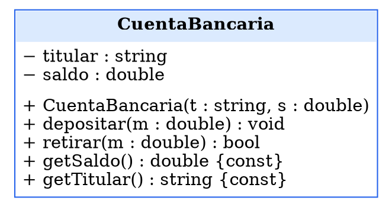

# 1. Información de soporte {.soporte}

:::analogia | El plano y las casas (o el molde y las galletas)
Un **plano** de casa no es una casa: describe cuántos cuartos tiene, dónde van las puertas y qué se puede hacer en ella. Con el mismo plano se construyen **muchas casas**, cada una con su propio color y sus propios muebles. En programación, el plano es la **clase** y cada casa es un **objeto**: todos los objetos de una clase tienen los mismos **atributos** (datos) y **métodos** (acciones), pero cada uno guarda **sus propios valores**.
:::

:::pregunta
En un videojuego hay 50 enemigos del mismo tipo: cada uno con su vida, su posición y su nivel, y todos saben «atacar» y «recibir daño». **¿Cómo lo programarías con estructuras y funciones? ¿Qué impide que una parte del programa ponga la vida de un enemigo en −500?**

{{lineas:2}}
:::

:::relevancia
Los motores de videojuegos (Unreal, Godot), las interfaces gráficas, las apps móviles y las bibliotecas de C++ (como `std::string` y `std::vector`, que ya usaste) están construidos con **clases**. La POO permite modelar el mundo real (cuentas, personajes, sensores) protegiendo sus datos y reutilizando código. Es el siguiente gran paso después de la programación estructurada de este curso. {{arcs:Relevancia}}
:::

## 1.1 Conceptos, uno por uno

:::concepto | 1 | De la estructura a la clase: datos + comportamiento | Elementos aislados, Atención dividida
En el Tema 13, los datos (`struct`) y las funciones que los usan estaban **separados**. Una clase los **une**: el objeto sabe hacer cosas con sus propios datos.

<div class="cols eq">
<div>

```cpp check title="estructura + funcion"
#include <iostream>
struct Cuenta { double saldo; };
void depositar(Cuenta& c, double m)
{
    c.saldo += m;
}
int main()
{
    Cuenta c{100};
    depositar(c, 50);
    c.saldo = -999;      // nada lo impide
    std::cout << c.saldo << "\n";
    return 0;
}
```

</div>
<div>

```cpp check title="clase"
#include <iostream>
class Cuenta
{
public:
    void depositar(double m)
    {
        if (m > 0) saldo += m;
    }
    double getSaldo() const { return saldo; }
private:
    double saldo = 100;  // protegido
};
int main()
{
    Cuenta c;
    c.depositar(50);
    // c.saldo = -999;  ERROR: es privado
    std::cout << c.getSaldo() << "\n";
    return 0;
}
```

</div>
</div>
:::

:::concepto | 2 | Atributos y métodos | Elementos aislados, Atención dividida
```cpp run title="perro.cpp"
#include <iostream>
#include <string>
using namespace std;

class Perro                          //> Definición de la CLASE (el plano)
{
public:
    string nombre;                   //> Atributos: lo que cada perro SABE de sí mismo
    int edad;
    void ladrar()                    //> Método: lo que cada perro SABE HACER
    {
        cout << nombre << " dice: Guau!\n";      //> Un método usa los atributos de SU objeto
    }
};                                   //> ¡Punto y coma, como en struct!

int main()
{
    Perro a, b;                      //> Dos OBJETOS (dos casas del mismo plano)
    a.nombre = "Firulais"; a.edad = 3;
    b.nombre = "Toby";     b.edad = 7;
    a.ladrar();                      //> Llamada: objeto.metodo()
    b.ladrar();                      //> El mismo método, con los datos de otro objeto
    return 0;
}
```
:::

:::concepto | 3 | Encapsulamiento: `private` y `public` | Elementos aislados, Atención dividida
El *C++ Crash Course* (cap. 2) muestra los **controles de acceso**: lo `private` solo se usa dentro de la clase; lo `public`, desde cualquier parte. Así la clase garantiza sus **invariantes** (reglas que siempre se cumplen):

```cpp run title="encapsulado.cpp"
#include <iostream>
using namespace std;
class Termostato
{
public:
    void fijar(double t)                     //> La ÚNICA forma de cambiar la temperatura…
    {
        if (t >= 10 && t <= 30) objetivo = t;      //> …y valida: el invariante 10 ≤ objetivo ≤ 30 siempre se cumple
        else cout << "Fuera de rango: " << t << "\n";
    }
    double leer() const { return objetivo; } //> «getter»: solo consulta
private:
    double objetivo = 22;                    //> Nadie de fuera puede escribir aquí directamente
};
int main()
{
    Termostato t;
    t.fijar(25);
    t.fijar(80);
    cout << "Objetivo: " << t.leer() << "\n";
    return 0;
}
```

```cpp err
class Termostato
{
private:
    double objetivo = 22;
};
int main()
{
    Termostato t;
    t.objetivo = 80;
    return 0;
}
```
Regla práctica: **atributos privados, métodos públicos**. En una `class` todo es privado salvo que se indique; en un `struct`, todo es público.
:::

:::movimiento | Objetos humanos (10 min)
Tres estudiantes son objetos de la clase `Cuenta`: cada uno tiene una hoja **oculta** (su saldo privado) y una tarjeta con sus métodos públicos: «depositar», «retirar», «consultar». El resto del grupo puede pedirles **solo** esas acciones (p. ej., «Cuenta de Ana: retira 500») y no puede tocar la hoja. Cada objeto aplica sus reglas (no permitir saldo negativo). Pregunta final: ¿por qué es imposible que alguien deje una cuenta en −500?
:::

:::concepto | 4 | Constructores: objetos que nacen listos | Elementos aislados, Atención dividida
Un **constructor** es un método especial que se ejecuta **al crear** el objeto: se llama igual que la clase y **no tiene tipo de retorno**. Puede haber varios (sobrecarga):

```cpp run title="constructores.cpp"
#include <iostream>
#include <string>
using namespace std;
class Alumno
{
public:
    Alumno()                                       //> Constructor por defecto (sin parámetros)
    {
        nombre = "Sin nombre";
        promedio = 0;
    }
    Alumno(string n, double p)                     //> Constructor con parámetros (sobrecarga)
    {
        nombre = n;
        promedio = (p >= 0 && p <= 10) ? p : 0;    //> Valida desde el nacimiento
    }
    void mostrar() const { cout << nombre << ": " << promedio << "\n"; }
private:
    string nombre;
    double promedio;
};
int main()
{
    Alumno a;                       //> Llama a Alumno()
    Alumno b("Eva", 9.3);           //> Llama a Alumno(string, double)
    Alumno c{"Iker", 15};           //> Con llaves; 15 es inválido → 0
    a.mostrar(); b.mostrar(); c.mostrar();
    return 0;
}
```
:::

:::concepto | 5 | El destructor: lo último que hace un objeto | Elementos aislados, Atención dividida
El **destructor** (`~Clase()`) se ejecuta automáticamente cuando el objeto **deja de existir**: al salir del bloque donde se creó (o con `delete`, si es dinámico). Sirve para liberar recursos (memoria, archivos). El *C++ Crash Course* (cap. 4) lo muestra «rastreando» el ciclo de vida:

```cpp run title="ciclo_vida.cpp"
#include <iostream>
#include <string>
using namespace std;
class Rastreador
{
public:
    Rastreador(string n) : nombre{n} { cout << "  + nace " << nombre << "\n"; }  //> Constructor
    ~Rastreador() { cout << "  - muere " << nombre << "\n"; }                       //> Destructor
private:
    string nombre;
};
int main()
{
    cout << "inicio de main\n";
    Rastreador a{"A"};
    {                                       //> Bloque interno
        Rastreador b{"B"};
        cout << "fin del bloque\n";
    }                                       //> Aquí muere B
    Rastreador* c = new Rastreador{"C"};    //> Objeto dinámico
    delete c;                               //> Muere C solo cuando se hace delete
    cout << "fin de main\n";
    return 0;                               //> Aquí muere A
}
```
:::

:::concepto | 6 | Métodos `const`, getters y el puntero `this` | Elementos aislados
- Un método marcado con `const` promete **no modificar** el objeto (los getters lo son). Sobre un objeto `const` solo se pueden llamar métodos `const`.
- Dentro de un método, `this` es un **puntero al objeto** que lo ejecuta; sirve, por ejemplo, para distinguir un atributo de un parámetro con el mismo nombre o para devolver el propio objeto.

```cpp run title="this_const.cpp"
#include <iostream>
using namespace std;
class Punto
{
public:
    Punto(int x, int y) { this->x = x; this->y = y; }   //> this->x es el atributo; x, el parámetro
    int getX() const { return x; }                       //> const: no modifica
    Punto& mover(int dx, int dy) { x += dx; y += dy; return *this; }   //> Devuelve el propio objeto
    void mostrar() const { cout << "(" << x << ", " << y << ")\n"; }
private:
    int x, y;
};
int main()
{
    Punto p(1, 2);
    p.mover(3, 0).mover(0, 5);       //> Llamadas encadenadas gracias a return *this
    p.mostrar();
    const Punto origen(0, 0);
    cout << origen.getX() << "\n";   //> Permitido: getX es const
    return 0;
}
```
:::

:::concepto | 7 | Ruta B · Definir los métodos fuera de la clase | Elementos aislados, Reversión de la experiencia
Betancourt y Polanco (cap. 13) tratan las clases «en línea» y «a nivel modular». En proyectos reales, la clase se **declara** (normalmente en un `.h`) y sus métodos se **definen** aparte con el operador de ámbito `::`. Además se usan **listas de inicialización**:

```cpp run title="modular.cpp"
#include <iostream>
#include <string>
using namespace std;

class Producto                                    // Declaración (lo que iría en Producto.h)
{
public:
    Producto(string n, double p, int e);
    void vender(int cant);
    double valorInventario() const;
    string getNombre() const;
private:
    string nombre;
    double precio;
    int existencias;
};

Producto::Producto(string n, double p, int e)     //> Definición fuera: Clase::metodo
    : nombre{n}, precio{p}, existencias{e}        //> Lista de inicialización
{
}
void Producto::vender(int cant)
{
    if (cant > 0 && cant <= existencias) existencias -= cant;
}
double Producto::valorInventario() const { return precio * existencias; }
string Producto::getNombre() const { return nombre; }

int main()
{
    Producto p{"Mochila", 520, 10};
    p.vender(3);
    cout << p.getNombre() << ": $" << p.valorInventario() << "\n";
    return 0;
}
```
:::

:::concepto | 8 | Arreglos de objetos | Elementos aislados
Los objetos se guardan en arreglos o vectores igual que cualquier tipo:

```cpp run title="arreglo_objetos.cpp"
#include <iostream>
#include <string>
#include <vector>
using namespace std;
class Enemigo
{
public:
    Enemigo(string n, int v) : nombre{n}, vida{v} {}
    void recibirDanio(int d) { vida = (vida > d) ? vida - d : 0; }
    bool vivo() const { return vida > 0; }
    string getNombre() const { return nombre; }
private:
    string nombre;
    int vida;
};
int main()
{
    vector<Enemigo> horda = {{"Orco", 30}, {"Goblin", 12}, {"Troll", 80}};
    for (Enemigo& e : horda) e.recibirDanio(25);       //> Mismo método, cada uno con sus datos
    for (const Enemigo& e : horda)
        cout << e.getNombre() << (e.vivo() ? " sigue vivo\n" : " derrotado\n");
    return 0;
}
```
:::

## 1.2 Ejemplo resuelto: la clase CuentaBancaria

:::ejemplo | Del enunciado al diagrama UML y al código | Ejemplo resuelto, Atención dividida
**Problema.** Modelar una cuenta bancaria con titular y saldo. Debe poder crearse con un saldo inicial (nunca negativo), recibir depósitos (solo positivos), permitir retiros (solo si hay fondos) y consultar su saldo. Nadie debe poder modificar el saldo directamente.

**A. Análisis (sustantivos → atributos, verbos → métodos, reglas → validaciones)**

| En el enunciado | Se convierte en |
|---|---|
| titular, saldo | atributos **privados** |
| crearse con saldo inicial | **constructor** |
| depositar, retirar, consultar | métodos **públicos** |
| «nunca negativo», «solo si hay fondos» | **invariante** validado en los métodos |

<div class="cols eq">
<div>

**B. Diagrama de clase (UML)**


*`−` privado · `+` público*

</div>
<div>

**C. Código en C++**

```cpp run title="cuenta.cpp"
#include <iostream>
#include <string>
using namespace std;

class CuentaBancaria
{
public:
    CuentaBancaria(string t, double s)
        : titular{t}, saldo{s >= 0 ? s : 0} {}
    void depositar(double m)
    {
        if (m > 0) saldo += m;
    }
    bool retirar(double m)
    {
        if (m <= 0 || m > saldo) return false;
        saldo -= m;
        return true;
    }
    double getSaldo() const { return saldo; }
    string getTitular() const { return titular; }
private:
    string titular;
    double saldo;
};

int main()
{
    CuentaBancaria c{"Ana Lopez", 1000};
    c.depositar(500);
    cout << "Retiro 2000: " << (c.retirar(2000) ? "ok" : "rechazado") << "\n";
    cout << "Retiro 300: " << (c.retirar(300) ? "ok" : "rechazado") << "\n";
    cout << c.getTitular() << " tiene $" << c.getSaldo() << "\n";
    return 0;
}
```

</div>
</div>

**D. Verificación.** 1000 + 500 = 1500; el retiro de 2000 se rechaza (invariante); el de 300 se acepta → 1200 ✔. Ninguna línea de `main` puede escribir `c.saldo`.
:::

:::resumen | Mapa del tema
```dot
rankdir=LR; nodesep=0.16; ranksep=0.3;
@term(cl, "class Nombre")
@proc(at, "atributos (private)\nlo que el objeto sabe")
@proc(me, "métodos (public)\nlo que el objeto hace")
@proc(co, "constructor Nombre(…)\nnace inicializado")
@proc(de, "destructor ~Nombre()\nal morir")
@proc(ob, "objeto: Nombre x{…};\nx.metodo()")
@sub(b, "const · this · Clase::metodo\nlista de inicialización")
@hl(nx, "Siguiente paso:\nherencia y polimorfismo")
cl -> at; cl -> me; cl -> co; cl -> de; cl -> ob; me -> b [style=dashed]; cl -> nx [style=dotted];
```
:::

# 2. Información procedimental {.procedimental}

:::sintaxis | Tarjeta de sintaxis 2.1 · Plantilla de clase
```cpp run title="plantilla_clase.cpp"
#include <iostream>
#include <string>
using namespace std;

class Nombre
{
public:
    Nombre(int a, string b) : atributo1{a}, atributo2{b} {}   // constructor
    ~Nombre() {}                                               // destructor (si hace falta)
    int getAtributo1() const { return atributo1; }             // consulta
    void setAtributo1(int v) { if (v >= 0) atributo1 = v; }    // modifica validando
    void accion() { cout << atributo2 << "\n"; }               // comportamiento
private:
    int atributo1;
    string atributo2;
};                                                             // ; final

int main()
{
    Nombre obj{5, "hola"};
    obj.setAtributo1(9);
    obj.accion();
    cout << obj.getAtributo1() << "\n";
    return 0;
}
```

| Quiero… | Escribo |
|---|---|
| Crear un objeto | `Clase obj{args};` · `Clase obj(args);` · `Clase obj;` (constructor por defecto) |
| Llamar un método | `obj.metodo(args);` · con puntero: `ptr->metodo(args);` |
| Objeto dinámico | `Clase* p = new Clase{args}; … delete p;` |
| Definir fuera de la clase | `tipo Clase::metodo(params) { … }` |
| Método que no modifica | `tipo metodo() const { … }` |
:::

:::checklist | Guía de preguntas de rutina 2.2 · Diseñar una clase
<ul class="checks">
<li>¿Qué <b>datos</b> describen al objeto (sustantivos)? → atributos <code>private</code>.</li>
<li>¿Qué <b>acciones</b> realiza o qué preguntas responde (verbos)? → métodos <code>public</code>.</li>
<li>¿Qué <b>reglas</b> deben cumplirse siempre? → validarlas en el constructor y en cada método que modifica.</li>
<li>¿Cómo nace un objeto válido? → constructor(es).</li>
<li>¿Los métodos que solo consultan están marcados <code>const</code>?</li>
<li>¿La definición termina en <code>};</code>?</li>
<li>¿Probé crear objetos con datos válidos e inválidos?</li>
</ul>
:::

:::errores | Errores frecuentes 2.3 | Variabilidad, Autoexplicación
**a) Constructor con tipo de retorno.** Un constructor no lleva `void` ni ningún otro tipo:

```cpp err
class Caja
{
public:
    void Caja() {}
};
int main() { return 0; }
```

**b) Acceder a un miembro privado desde fuera** (concepto 3): *is private within this context*.

**c) Llamar a un método no `const` sobre un objeto `const`.**

```cpp err
class Contador
{
public:
    int valor() { return n; }
private:
    int n = 0;
};
int main()
{
    const Contador c;
    return c.valor();
}
```
*Corrección:* `int valor() const { return n; }`.

**d) Olvidar los argumentos del constructor.** Si la clase solo tiene `Alumno(string, double)`, `Alumno a;` no compila: no hay constructor por defecto.

**e) Usar el nombre de la clase en lugar del objeto:** `Perro.ladrar();` → `a.ladrar();`.
:::

:::isomorfo | Ejemplo isomórfico 2.4 · Un semáforo como objeto | Variabilidad
El mismo diseño (estado privado + métodos que lo cambian con reglas), en otro contexto:

```cpp run title="semaforo_clase.cpp"
#include <iostream>
#include <string>
using namespace std;
class Semaforo
{
public:
    void avanzar() { estado = (estado + 1) % 3; }        //> Solo puede pasar al siguiente color
    string color() const
    {
        switch (estado) { case 0: return "verde"; case 1: return "amarillo"; default: return "rojo"; }
    }
private:
    int estado = 0;                                      //> 0, 1 o 2: nadie puede poner 7
};
int main()
{
    Semaforo s;
    for (int i = 0; i < 5; i++) { cout << s.color() << " "; s.avanzar(); }
    cout << "\n";
    return 0;
}
```
:::

# 3. Tareas de aprendizaje {.tareas}

{{ef:Desvanecimiento de guía}} Antes de programar cada clase, dibuja su diagrama UML (nombre, atributos, métodos).

:::tarea A | T1. La clase Rectangulo: ejemplo y gemelo | 25 min | Ejemplo resuelto, Variabilidad
**Paso 1 · Estudia:**

```cpp run title="rectangulo.cpp"
#include <iostream>
using namespace std;

class Rectangulo
{
public:
    Rectangulo(double b, double h)                    //> Nace con medidas válidas
    {
        base = (b > 0) ? b : 1;
        altura = (h > 0) ? h : 1;
    }
    double area() const { return base * altura; }     //> Métodos que calculan con SUS atributos
    double perimetro() const { return 2 * (base + altura); }
    bool esCuadrado() const { return base == altura; }
private:
    double base, altura;
};

int main()
{
    Rectangulo r1(4, 3), r2(5, 5), r3(-2, 6);         //> Tres objetos independientes
    cout << "r1: area " << r1.area() << ", perimetro " << r1.perimetro() << "\n";
    cout << "r2 es cuadrado: " << boolalpha << r2.esCuadrado() << "\n";
    cout << "r3 (base invalida corregida): area " << r3.area() << "\n";
    return 0;
}
```

**Paso 2 · Gemelo.** Escribe la clase `Circulo` con el radio privado (validado), y los métodos `area()`, `perimetro()` y `escalar(double factor)` (que multiplica el radio si el factor es positivo). Crea dos círculos y pruébalos.

:::solucion | T1
```cpp run title="circulo.cpp"
#include <iostream>
using namespace std;
class Circulo
{
public:
    Circulo(double r) { radio = (r > 0) ? r : 1; }
    double area() const { return PI * radio * radio; }
    double perimetro() const { return 2 * PI * radio; }
    void escalar(double f) { if (f > 0) radio *= f; }
private:
    static constexpr double PI = 3.14159265358979;
    double radio;
};
int main()
{
    Circulo a(2.5), b(1);
    b.escalar(3);
    cout << "a: " << a.area() << " / " << a.perimetro() << "\n";
    cout << "b: " << b.area() << " / " << b.perimetro() << "\n";
    return 0;
}
```
:::
:::

:::tarea A | T2. La clase Temperatura (completa con pistas) | 25 min | Problema por completar
**Contexto.** Una estación meteorológica guarda la temperatura en Celsius (nunca menor que −273.15) y la ofrece en otras escalas.

```cpp blank title="temperatura.cpp"
#include <iostream>
using namespace std;
class Temperatura
{
__1__:                                   // 1: seccion accesible desde fuera
    __2__(double c) { fijar(c); }        // 2: constructor
    void fijar(double c)
    {
        if (c >= -273.15) celsius = c;
        else celsius = -273.15;
    }
    double enFahrenheit() __3__ { return 9.0 / 5 * celsius + 32; }   // 3: no modifica el objeto
    double enKelvin() const { return __4__; }                         // 4: formula
__5__:                                   // 5: seccion oculta
    double celsius;
};
int main()
{
    Temperatura t(36.5);
    cout << t.enFahrenheit() << " F, " << t.enKelvin() << " K\n";
    t.fijar(-500);
    cout << t.enKelvin() << " K\n";
    return 0;
}
```

:::solucion | T2
{{c:1}} `public` · {{c:2}} `Temperatura` · {{c:3}} `const` · {{c:4}} `celsius + 273.15` · {{c:5}} `private`

```cpp run title="temperatura.cpp"
#include <iostream>
using namespace std;
class Temperatura
{
public:
    Temperatura(double c) { fijar(c); }
    void fijar(double c)
    {
        if (c >= -273.15) celsius = c;
        else celsius = -273.15;
    }
    double enFahrenheit() const { return 9.0 / 5 * celsius + 32; }
    double enKelvin() const { return celsius + 273.15; }
private:
    double celsius;
};
int main()
{
    Temperatura t(36.5);
    cout << t.enFahrenheit() << " F, " << t.enKelvin() << " K\n";
    t.fijar(-500);
    cout << t.enKelvin() << " K\n";
    return 0;
}
```
El constructor **reutiliza** el método `fijar`: la validación se escribe una sola vez.
:::
:::

:::tarea AB | T3. La clase Fraccion (completa sin pistas) | 30 min | Problema por completar, Desvanecimiento de guía
**Contexto.** Una fracción nunca tiene denominador 0 y siempre se guarda **simplificada** (usa el MCD del Tema 11).

```cpp blank title="fraccion.cpp"
#include <iostream>
using namespace std;
int mcd(int a, int b) { return b == 0 ? a : mcd(b, a % b); }

class Fraccion
{
public:
    Fraccion(int n, int d)
    {
        if (d == 0) d = 1;
        if (d < 0) { n = -n; d = -d; }
        int m = mcd(n < 0 ? -n : n, d);
        num = __1__;
        den = __2__;
    }
    Fraccion sumar(const Fraccion& o) __3__
    {
        return Fraccion(__4__, __5__);
    }
    void mostrar() const { cout << num << "/" << den; }
__6__:
    int num, den;
};

int main()
{
    Fraccion a(1, 2), b(2, 6), c(4, -8);
    a.mostrar(); cout << " + "; b.mostrar(); cout << " = ";
    a.sumar(b).mostrar(); cout << "\n";
    c.mostrar(); cout << "\n";
    return 0;
}
```

:::solucion | T3
{{c:1}} `n / m` · {{c:2}} `d / m` · {{c:3}} `const` · {{c:4}} `num * o.den + o.num * den` · {{c:5}} `den * o.den` · {{c:6}} `private`

```cpp run title="fraccion.cpp"
#include <iostream>
using namespace std;
int mcd(int a, int b) { return b == 0 ? a : mcd(b, a % b); }

class Fraccion
{
public:
    Fraccion(int n, int d)
    {
        if (d == 0) d = 1;
        if (d < 0) { n = -n; d = -d; }
        int m = mcd(n < 0 ? -n : n, d);
        num = n / m;
        den = d / m;
    }
    Fraccion sumar(const Fraccion& o) const
    {
        return Fraccion(num * o.den + o.num * den, den * o.den);
    }
    void mostrar() const { cout << num << "/" << den; }
private:
    int num, den;
};

int main()
{
    Fraccion a(1, 2), b(2, 6), c(4, -8);
    a.mostrar(); cout << " + "; b.mostrar(); cout << " = ";
    a.sumar(b).mostrar(); cout << "\n";
    c.mostrar(); cout << "\n";
    return 0;
}
```
Observa que `sumar` accede a `o.num` aunque es privado: el acceso privado es **por clase**, no por objeto.
:::
:::

:::tarea AB | T4. El personaje de videojuego (problema convencional) | 35 min | Variabilidad
**Contexto.** Diseña `class Personaje` con nombre, vida (0 a vidaMaxima), vidaMaxima, nivel y ataque. Métodos: `recibirDanio(int)`, `curar(int)` (sin pasar del máximo), `subirNivel()` (+10 vida máxima, +2 ataque, cura por completo), `estaVivo()`, `atacar(Personaje& otro)` y `mostrar()`. Simula un combate por turnos entre dos personajes hasta que uno caiga.

:::solucion | T4
```cpp run title="combate.cpp"
#include <iostream>
#include <string>
using namespace std;
class Personaje
{
public:
    Personaje(string n, int vidaMax, int atq)
        : nombre{n}, vidaMaxima{vidaMax > 0 ? vidaMax : 1}, vida{vidaMaxima}, nivel{1}, ataque{atq} {}
    void recibirDanio(int d) { if (d > 0) vida = (vida > d) ? vida - d : 0; }
    void curar(int c) { if (c > 0) vida = (vida + c < vidaMaxima) ? vida + c : vidaMaxima; }
    void subirNivel() { nivel++; vidaMaxima += 10; ataque += 2; vida = vidaMaxima; }
    bool estaVivo() const { return vida > 0; }
    void atacar(Personaje& otro) const { otro.recibirDanio(ataque); }
    void mostrar() const { cout << nombre << " (nv " << nivel << ") " << vida << "/" << vidaMaxima << "\n"; }
private:
    string nombre;
    int vidaMaxima, vida, nivel, ataque;
};
int main()
{
    Personaje heroe("Lyra", 40, 9), jefe("Golem", 60, 7);
    heroe.subirNivel();
    int turno = 1;
    while (heroe.estaVivo() && jefe.estaVivo())
    {
        heroe.atacar(jefe);
        if (jefe.estaVivo()) jefe.atacar(heroe);
        if (turno % 3 == 0) heroe.curar(5);
        cout << "Turno " << turno++ << ": "; heroe.mostrar();
        cout << "         "; jefe.mostrar();
    }
    cout << (heroe.estaVivo() ? "Gana Lyra\n" : "Gana el Golem\n");
    return 0;
}
```
Observa el orden de los atributos: `vida{vidaMaxima}` funciona porque `vidaMaxima` se declaró **antes** que `vida` (los atributos se inicializan en el orden en que se declaran).
:::
:::

:::tarea A | T5. Diseña una mascota virtual (solución libre) | 30 min | Solución libre
**Contexto.** Diseña la clase `Mascota` para un juego de mascota virtual. **No hay una lista obligatoria:** incluye **todos los atributos y métodos que se te ocurran** (hambre, energía, felicidad, edad, `comer()`, `jugar()`, `dormir()`, `pasarTiempo()`, `estado()`…), con sus reglas (por ejemplo, ningún indicador fuera de 0 a 100). Dibuja el diagrama UML y programa al menos cuatro métodos.

:::solucion | T5
Una propuesta (hay muchas válidas):

```cpp run title="mascota.cpp"
#include <iostream>
#include <string>
using namespace std;
class Mascota
{
public:
    Mascota(string n) : nombre{n} {}
    void comer()  { hambre = limitar(hambre - 30); energia = limitar(energia + 5); }
    void jugar()  { felicidad = limitar(felicidad + 20); energia = limitar(energia - 25); hambre = limitar(hambre + 10); }
    void dormir() { energia = 100; hambre = limitar(hambre + 15); }
    void pasarTiempo() { hambre = limitar(hambre + 10); felicidad = limitar(felicidad - 5); edad++; }
    string estado() const
    {
        if (hambre > 80) return "hambrienta";
        if (energia < 20) return "cansada";
        if (felicidad > 70) return "feliz";
        return "tranquila";
    }
    void mostrar() const
    {
        cout << nombre << " [" << estado() << "] hambre " << hambre << ", energia " << energia
             << ", felicidad " << felicidad << ", edad " << edad << "\n";
    }
private:
    static int limitar(int v) { return v < 0 ? 0 : (v > 100 ? 100 : v); }
    string nombre;
    int hambre = 50, energia = 70, felicidad = 50, edad = 0;
};
int main()
{
    Mascota m("Pixel");
    m.jugar(); m.jugar(); m.mostrar();
    m.pasarTiempo(); m.comer(); m.dormir(); m.mostrar();
    return 0;
}
```
:::
:::

:::tarea B | T6. La clase que no compila (autoexplicación) | 20 min | Autoexplicación, Reversión de la experiencia
**Explica** por qué cada línea marcada produce un error y corrígela.

```cpp blank title="clase_bug.cpp"
class Libro
{
    string titulo;
    int paginas;
public:
    void Libro(string t, int p) { titulo = t; paginas = p; }   // (1)
    int getPaginas() { return paginas; }
}                                                             // (2)
int main()
{
    Libro a;                                                  // (3)
    Libro b("Rayuela", 600);
    b.paginas = 700;                                          // (4)
    const Libro c("Ficciones", 200);
    cout << c.getPaginas();                                   // (5)
}
```

{{lineas:5}}

:::solucion | T6
(1) Un constructor no tiene tipo de retorno: `Libro(string t, int p)`. (2) Falta `;` al final de la clase. (3) No existe constructor por defecto (solo uno con parámetros): agregar `Libro() : titulo{""}, paginas{0} {}` o crear con argumentos. (4) `paginas` es **privado** (en `class`, lo que va antes de `public:` es privado). (5) `c` es `const` y `getPaginas` no está marcado `const`. También faltan `#include` de `<iostream>` y `<string>`.

```cpp run title="libro_ok.cpp"
#include <iostream>
#include <string>
using namespace std;
class Libro
{
public:
    Libro() : titulo{""}, paginas{0} {}
    Libro(string t, int p) : titulo{t}, paginas{p > 0 ? p : 1} {}
    int getPaginas() const { return paginas; }
    void setPaginas(int p) { if (p > 0) paginas = p; }
private:
    string titulo;
    int paginas;
};
int main()
{
    Libro a;
    Libro b("Rayuela", 600);
    b.setPaginas(700);
    const Libro c("Ficciones", 200);
    cout << b.getPaginas() << " " << c.getPaginas() << "\n";
    return 0;
}
```
:::
:::

:::tarea B | T7. ¿Quién nace y quién muere? (imaginación) | 20 min | Imaginación
**Sin ejecutar**, imagina el ciclo de vida de los objetos y escribe la salida **en orden**. Pista: los objetos de un mismo bloque se destruyen en orden **inverso** al de su creación.

```cpp check title="imagina_ciclo.cpp"
#include <iostream>
using namespace std;
class T
{
public:
    T(char c) : id{c} { cout << "+" << id << " "; }
    ~T() { cout << "-" << id << " "; }
private:
    char id;
};
void f()
{
    T x{'x'};
}
int main()
{
    T a{'a'};
    {
        T b{'b'};
        T c{'c'};
    }
    f();
    T* d = new T{'d'};
    T e{'e'};
    delete d;
    cout << "| ";
    return 0;
}
```

{{lineas:2}}

:::solucion | T7
`+a`; en el bloque `+b +c` y al cerrarlo `-c -b` (inverso); `f()` crea y destruye `x`: `+x -x`; `+d` (dinámico); `+e`; `delete d` → `-d`; se imprime `|`; al terminar `main` se destruyen `e` y luego `a` (inverso).

```cpp run title="imagina_ciclo.cpp"
#include <iostream>
using namespace std;
class T
{
public:
    T(char c) : id{c} { cout << "+" << id << " "; }
    ~T() { cout << "-" << id << " "; }
private:
    char id;
};
void f()
{
    T x{'x'};
}
int main()
{
    T a{'a'};
    {
        T b{'b'};
        T c{'c'};
    }
    f();
    T* d = new T{'d'};
    T e{'e'};
    delete d;
    cout << "| ";
    return 0;
}
```
:::
:::

:::tarea AB | T8. Biblioteca escolar (reto colaborativo) | 45 min | Memoria colectiva de trabajo, Variabilidad
:::colab | Organización
Equipos de 4, niveles mezclados. Dos clases que colaboran:
- **`Libro`** (integrantes 1 y 2): código, título, disponible; métodos `prestar()` y `devolver()` que devuelven `bool` (no se presta un libro prestado ni se devuelve uno disponible), `mostrar()`.
- **`Biblioteca`** (integrantes 3 y 4): guarda un `vector<Libro>`; métodos `agregar(Libro)`, `Libro* buscar(int codigo)` (devuelve `nullptr` si no existe), `prestar(int codigo)`, `devolver(int codigo)`, `inventario()` (cuántos disponibles y prestados).

Primero acuerden en el pizarrón los diagramas UML (el «contrato» entre las dos parejas); después cada pareja programa y prueba su clase; al final integran y prueban un escenario completo.
:::

:::solucion | T8
```cpp run title="biblioteca.cpp"
#include <iostream>
#include <string>
#include <vector>
using namespace std;
class Libro
{
public:
    Libro(int c, string t) : codigo{c}, titulo{t} {}
    bool prestar() { if (!disponible) return false; disponible = false; return true; }
    bool devolver() { if (disponible) return false; disponible = true; return true; }
    int getCodigo() const { return codigo; }
    bool estaDisponible() const { return disponible; }
    void mostrar() const { cout << "[" << codigo << "] " << titulo << (disponible ? "" : " (prestado)") << "\n"; }
private:
    int codigo;
    string titulo;
    bool disponible = true;
};
class Biblioteca
{
public:
    void agregar(const Libro& l) { libros.push_back(l); }
    Libro* buscar(int c)
    {
        for (Libro& l : libros) if (l.getCodigo() == c) return &l;
        return nullptr;
    }
    void prestar(int c)
    {
        Libro* l = buscar(c);
        cout << "Prestar " << c << ": " << (l == nullptr ? "no existe" : (l->prestar() ? "ok" : "ya estaba prestado")) << "\n";
    }
    void devolver(int c)
    {
        Libro* l = buscar(c);
        cout << "Devolver " << c << ": " << (l == nullptr ? "no existe" : (l->devolver() ? "ok" : "no estaba prestado")) << "\n";
    }
    void inventario() const
    {
        int disp = 0;
        for (const Libro& l : libros) { l.mostrar(); if (l.estaDisponible()) disp++; }
        cout << disp << " disponibles, " << libros.size() - disp << " prestados\n";
    }
private:
    vector<Libro> libros;
};
int main()
{
    Biblioteca b;
    b.agregar(Libro(1, "El principito"));
    b.agregar(Libro(2, "Rayuela"));
    b.agregar(Libro(3, "Ficciones"));
    b.prestar(2); b.prestar(2); b.prestar(9); b.devolver(3);
    b.inventario();
    return 0;
}
```
:::
:::

# 4. Protocolo verbal {.protocolo}

:::protocolo | Protocolo verbal · Diseñar una clase a partir de un enunciado | Modalidad, Ejemplo resuelto
*Guion segmentado (≈ 4 min), con el enunciado subrayado y el diagrama UML construyéndose en pantalla.*

**Problema:** «Un cronómetro de competencias puede iniciarse, detenerse, reiniciarse y registrar vueltas; debe informar el tiempo total y la vuelta más rápida. No se puede detener si no está corriendo».

**Segmento 1 — Subrayar sustantivos y verbos.** {{como}} Subrayo los **sustantivos** (tiempo total, vueltas, estado «corriendo») y los **verbos** (iniciar, detener, reiniciar, registrar vuelta, informar). {{porque}} Los sustantivos suelen ser atributos y los verbos, métodos: es la forma más directa de pasar del texto al diseño.

**Segmento 2 — Encontrar las reglas.** {{como}} Marco las frases con «no se puede» o «debe»: «no se puede detener si no está corriendo». Esa regla depende de un atributo `bool corriendo`, que debe ser **privado**. {{porque}} Si fuera público, cualquiera podría ponerlo en `true` sin iniciar el cronómetro y romper la regla.

**Segmento 3 — Elegir qué datos guardar.** {{como}} Para «vuelta más rápida» no necesito guardar todas las vueltas: basta un contador y el mínimo. {{porque}} Guardar solo lo necesario reduce errores; si después se pide la lista completa, cambiaré lo privado sin afectar a quien use la clase.

**Segmento 4 — Probar los métodos como un usuario malicioso.** {{como}} Pruebo `detener()` sin haber llamado a `iniciar()` y registrar una vuelta con el cronómetro detenido. {{porque}} Una clase bien encapsulada debe **resistir** el mal uso, no solo funcionar en el caso feliz. (Para no depender del reloj real, aquí los segundos se simulan con un parámetro.)

{{salto}}

```cpp run title="cronometro.cpp"
#include <iostream>
using namespace std;
class Cronometro
{
public:
    bool iniciar() { if (corriendo) return false; corriendo = true; return true; }
    bool detener() { if (!corriendo) return false; corriendo = false; return true; }
    bool vuelta(double seg)
    {
        if (!corriendo || seg <= 0) return false;
        total += seg;
        vueltas++;
        if (mejor == 0 || seg < mejor) mejor = seg;
        return true;
    }
    void reiniciar() { corriendo = false; total = 0; vueltas = 0; mejor = 0; }
    void informe() const
    {
        cout << vueltas << " vueltas, total " << total << " s, mejor " << mejor << " s\n";
    }
private:
    bool corriendo = false;
    double total = 0, mejor = 0;
    int vueltas = 0;
};
int main()
{
    Cronometro c;
    cout << "Detener sin iniciar: " << (c.detener() ? "aceptado" : "rechazado") << "\n";
    c.iniciar();
    c.vuelta(62.4); c.vuelta(59.8); c.vuelta(61.0);
    c.detener();
    cout << "Vuelta detenido: " << (c.vuelta(50) ? "aceptada" : "rechazada") << "\n";
    c.informe();
    return 0;
}
```
:::

# 5. Evaluación {.evaluacion}

:::recall | 5.1 Recall test · conocimiento declarativo
1. ¿Qué diferencia hay entre una clase y un objeto?
2. ¿Qué es un atributo y qué es un método?
3. ¿Qué significa encapsular y qué palabras de C++ lo permiten?
4. ¿Cómo se llama el constructor de la clase `Robot` y qué tipo de retorno tiene?
5. ¿Cuándo se ejecuta el destructor de un objeto local? ¿Y el de uno creado con `new`?
6. Verdadero o falso: en una `class`, los miembros son públicos si no se indica otra cosa.
7. ¿Qué indica `const` al final de la firma de un método?
8. ¿Para qué sirve el puntero `this`?
9. ¿Qué operador se usa para definir un método fuera de la clase?
10. ¿En qué orden se destruyen dos objetos creados en el mismo bloque?
:::

:::compr | 5.2 Comprehension test · conocimiento procedimental
**P1. Predice la salida:**

```cpp check title="p1.cpp"
#include <iostream>
using namespace std;
class Caja
{
public:
    Caja(int v) : valor{v} { cout << "C" << valor << " "; }
    ~Caja() { cout << "D" << valor << " "; }
    void doblar() { valor *= 2; }
    int get() const { return valor; }
private:
    int valor;
};
int main()
{
    Caja a{3};
    {
        Caja b{a.get() + 1};
        b.doblar();
        cout << b.get() << " ";
    }
    a.doblar();
    cout << a.get() << " ";
    return 0;
}
```

**P2.** Dibuja el diagrama UML de una clase `Reloj` (horas, minutos) con constructor validado, `avanzarMinuto()` (que pase de 23:59 a 00:00) y `mostrar()`, y prográmala.

**P3. Corrige:** `class Punto { int x; int y; }; Punto p; p.x = 3; cout << p.x;` — explica dos formas distintas de hacerlo compilar y cuál respeta el encapsulamiento.

**P4. Desarrolla** la clase `Alcancia` con un arreglo privado que cuenta monedas de $1, $2, $5 y $10; métodos `meter(int denominacion)` (rechaza denominaciones inválidas), `total()` y `romper()` (devuelve el total y la deja vacía). Prueba con una secuencia de monedas.
:::

:::registro | 5.3 Autorregistro
<ul class="checks">
<li>Diseño una clase a partir de un enunciado (atributos, métodos, reglas).</li>
<li>Uso <code>private</code> y <code>public</code> para proteger los datos.</li>
<li>Escribo constructores que dejan al objeto en un estado válido.</li>
<li>Explico cuándo se construye y se destruye cada objeto.</li>
</ul>
**Esfuerzo mental invertido** (1 = muy, muy bajo · 9 = muy, muy alto):
<div class="escala"><span><b>1</b></span><span><b>2</b></span><span><b>3</b></span><span><b>4</b></span><span><b>5</b></span><span><b>6</b></span><span><b>7</b></span><span><b>8</b></span><span><b>9</b></span></div>
*Cierre del curso: el instructor aplica la evaluación final de la Fase 3 (MSLQ final, CIS, IMMS y encuesta de carga cognitiva) y decide si iterar alguna fase del modelo (ver Tema 00).*
:::

:::solucion | Evaluación 5.1 (recall)
1 La clase es la definición (el plano); el objeto es una variable concreta de esa clase · 2 Un atributo es un dato del objeto; un método es una función que pertenece a la clase y opera sobre el objeto · 3 Ocultar los datos y exponer solo operaciones seguras; `private` y `public` · 4 `Robot`; no tiene tipo de retorno · 5 Al salir del bloque donde se creó; cuando se hace `delete` · 6 Falso: en `class` son privados por defecto (en `struct`, públicos) · 7 Que el método no modifica el objeto · 8 Es un puntero al objeto que ejecuta el método (p. ej., para distinguir atributos de parámetros o devolver `*this`) · 9 `::` · 10 En orden inverso al de su creación.
:::

:::solucion | Evaluación 5.2 (comprehension)
**P1.** `C3`, `C4`, `b` se duplica (8), `D8` al cerrar el bloque, `a` se duplica (6), y al final `D6`.

```cpp run title="p1.cpp"
#include <iostream>
using namespace std;
class Caja
{
public:
    Caja(int v) : valor{v} { cout << "C" << valor << " "; }
    ~Caja() { cout << "D" << valor << " "; }
    void doblar() { valor *= 2; }
    int get() const { return valor; }
private:
    int valor;
};
int main()
{
    Caja a{3};
    {
        Caja b{a.get() + 1};
        b.doblar();
        cout << b.get() << " ";
    }
    a.doblar();
    cout << a.get() << " ";
    return 0;
}
```

**P2.**

```cpp run title="reloj.cpp"
#include <iostream>
#include <iomanip>
using namespace std;
class Reloj
{
public:
    Reloj(int h, int m) : horas{(h >= 0 && h < 24) ? h : 0}, minutos{(m >= 0 && m < 60) ? m : 0} {}
    void avanzarMinuto()
    {
        minutos++;
        if (minutos == 60) { minutos = 0; horas = (horas + 1) % 24; }
    }
    void mostrar() const
    {
        cout << setfill('0') << setw(2) << horas << ":" << setw(2) << minutos << "\n";
    }
private:
    int horas, minutos;
};
int main()
{
    Reloj r(23, 58);
    r.mostrar(); r.avanzarMinuto(); r.mostrar(); r.avanzarMinuto(); r.mostrar();
    return 0;
}
```

**P3.** Los miembros de una `class` son privados por defecto. Forma 1: poner `public:` antes de `x` e `y` (compila, pero **rompe** el encapsulamiento). Forma 2 (recomendada): dejarlos privados y agregar un constructor y métodos `getX()`/`setX()` que validen.

**P4.**

```cpp run title="alcancia.cpp"
#include <iostream>
using namespace std;
class Alcancia
{
public:
    bool meter(int d)
    {
        for (int i = 0; i < 4; i++)
            if (DENOM[i] == d) { cantidad[i]++; return true; }
        return false;
    }
    int total() const
    {
        int t = 0;
        for (int i = 0; i < 4; i++) t += DENOM[i] * cantidad[i];
        return t;
    }
    int romper()
    {
        int t = total();
        for (int i = 0; i < 4; i++) cantidad[i] = 0;
        return t;
    }
private:
    static constexpr int DENOM[4] = {1, 2, 5, 10};
    int cantidad[4] = {};
};
int main()
{
    Alcancia a;
    int monedas[] = {5, 10, 3, 1, 10, 2, 7, 5};
    for (int m : monedas)
        if (!a.meter(m)) cout << "Moneda invalida: " << m << "\n";
    cout << "Total: $" << a.total() << "\n";
    cout << "Al romperla: $" << a.romper() << ", queda $" << a.total() << "\n";
    return 0;
}
```
:::
